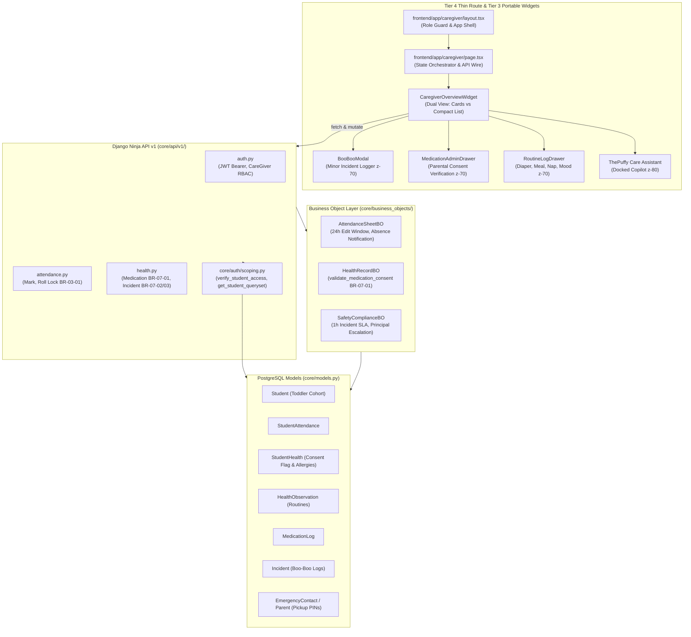
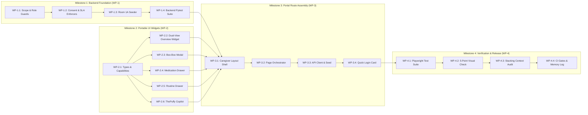

# Delivery Plan

Status reflects repository code/tests reviewed on 2026-10-11. `Done` means the listed acceptance check is present and covered by current code/tests; `Partial` means implementation exists but scope or verification is incomplete; `Planned` means no sufficient implementation evidence was found. Dependencies reference task IDs below. Detailed rules live in [rule_registry.md](rule_registry.md); product outcomes live in [PRD.md](PRD.md).

## Sprint 1 — Tenant Foundation and Admissions

| ID    | Task                                                 | Depends on   | Acceptance check                                                                                                                                                                                                                                                  | Status  |
| ----- | ---------------------------------------------------- | ------------ | ----------------------------------------------------------------------------------------------------------------------------------------------------------------------------------------------------------------------------------------------------------------- | ------- |
| S1-01 | Tenant-scoped entities and student numbering         | —            | Tenant base/audit fields exist; student numbers are atomic and tenant-prefixed; generator tests pass.                                                                                                                                                             | Done    |
| S1-02 | Authentication, role membership, and request context | S1-01        | Login verifies passwords and membership; signed JWT is validated; unauthorized roles fail; production secrets fail closed. Refresh/revocation and production identity lifecycle remain absent.                                                                    | Partial |
| S1-03 | Database tenant isolation                            | S1-01, S1-02 | Every tenant table has tested forced RLS policies and cross-tenant access tests pass. Current migrations cover portal-role membership only.                                                                                                                       | Partial |
| S1-04 | Admissions lifecycle and access                      | S1-01, S1-02 | Parent/Admin enrollment, documents, decisions, offer acceptance, and payment confirmation pass workflow and isolation tests. Full policy/role coverage remains incomplete.                                                                                        | Partial |
| S1-05 | Admin school setup imports                           | S1-01, S1-02 | Admin config is tenant-scoped; batches are schema/template validated and transactional; Student import creates Student+Parent without Application; all requested datasets have passing tests. Current tests cover representative datasets, not every import type. | Partial |

## Sprint 2 — Academics and Assessment

| ID    | Task                                   | Depends on          | Acceptance check                                                                                                                                           | Status  |
| ----- | -------------------------------------- | ------------------- | ---------------------------------------------------------------------------------------------------------------------------------------------------------- | ------- |
| S2-01 | Academic entities and calendar         | S1-01               | Curriculum, calendar, lesson, assignment, exam, marks, and report-card models/migrations exist; calendar date checks pass.                                 | Partial |
| S2-02 | Curriculum, lesson, and exam workflows | S2-01, S1-02        | BO rules reject invalid mappings, holiday dates, and exam overlaps; tenant-scoped API tests pass.                                                          | Partial |
| S2-03 | Marks moderation and report cards      | S2-01, S2-02        | Marks lock/moderation and report-card publication gates have pass/fail tests; published records are what Parent views expose.                              | Partial |
| S2-04 | Academic portal workflows              | S2-02, S2-03, S6-01 | Teacher/Admin can complete planned calendar, lesson, exam, marks, and report workflows; missing planned endpoints and UI states are enumerated and closed. | Partial |

## Sprint 3 — Attendance, Rostering, Health, and Safety

| ID    | Task                                 | Depends on   | Acceptance check                                                                                                                                                        | Status  |
| ----- | ------------------------------------ | ------------ | ----------------------------------------------------------------------------------------------------------------------------------------------------------------------- | ------- |
| S3-01 | Attendance and leave models/BOs/APIs | S1-01, S1-02 | Attendance, leave, roster, lock-window, status, and tenant tests pass.                                                                                                  | Partial |
| S3-02 | Health and safeguarding controls     | S1-01, S1-02 | Health/medication consent, incident escalation, and compliance API tests pass; field-level access policy is verified for each role.                                     | Partial |
| S3-03 | Role-scoped attendance screens       | S3-01, S6-01 | Admin/Principal/Teacher attendance screens use server-scoped data and meet responsive/accessibility checks. Shared student attendance exists; full role parity remains. | Partial |
| S3-04 | Offline attendance and sync          | S3-01, S3-03 | Offline marks survive reload, sync idempotently on reconnect, and report conflict/failure states. No durable PWA sync implementation verified.                          | Planned |

## Sprint 4 — Billing and Finance

| ID    | Task                                           | Depends on          | Acceptance check                                                                                                                                                                                                                                                            | Status  |
| ----- | ---------------------------------------------- | ------------------- | --------------------------------------------------------------------------------------------------------------------------------------------------------------------------------------------------------------------------------------------------------------------------- | ------- |
| S4-01 | Fee structures, invoices, and account balances | S1-01, S1-02        | Decimal totals, invoice states, tenant scope, and balance math pass billing API/BO tests.                                                                                                                                                                                   | Partial |
| S4-02 | Discounts, refunds, and reconciliation         | S4-01, S1-02        | Approval gates, refund behavior, audit data, and reconciliation discrepancy rules pass dedicated tests.                                                                                                                                                                     | Partial |
| S4-03 | Stripe Checkout and webhook lifecycle          | S4-01, S4-02, S1-02 | Partial amounts cannot exceed current balance; invalid signatures do not complete payment; duplicate webhooks are idempotent; live Stripe test-mode checkout and deployment secrets are verified. Automated tests pass; live credential-backed checkout remains unverified. | Partial |
| S4-04 | Parent billing experience                      | S4-01, S4-03, S6-01 | Parent sees only linked children’s invoices/payment history and can start hosted checkout; browser return state never indicates payment success without server confirmation.                                                                                                | Partial |

## Sprint 5 — HR, Procurement, Events, and Communications

| ID    | Task                             | Depends on                 | Acceptance check                                                                                                                                        | Status  |
| ----- | -------------------------------- | -------------------------- | ------------------------------------------------------------------------------------------------------------------------------------------------------- | ------- |
| S5-01 | Staff, compliance, and payroll   | S1-01, S1-02               | Staff/DBS and payroll leave-deduction rules have API/BO tests and role checks.                                                                          | Partial |
| S5-02 | Vendor and procurement workflows | S1-01, S1-02               | Vendor, requisition, purchase order, delivery, invoice, and 3-way match paths have tenant/security tests.                                               | Partial |
| S5-03 | Events and communications        | S1-02, S4-01               | Events and messages validate business rules, preserve permissions, and expose delivery states backed by a configured provider.                          | Partial |
| S5-04 | Operational portals              | S5-01, S5-02, S5-03, S6-01 | Staff/vendor workflows are usable end-to-end with server-side authorization and error/empty states. Route/API foundations exist; breadth is incomplete. | Partial |

## Sprint 6 — Operational Portals and Design System

| ID    | Task                                   | Depends on                 | Acceptance check                                                                                                              | Status  |
| ----- | -------------------------------------- | -------------------------- | ----------------------------------------------------------------------------------------------------------------------------- | ------- |
| S6-01 | Shared tokens and component foundation | —                          | Semantic tokens and shared UI/PC primitives exist; no parallel primitives are added; changed UI passes focused lint/build.    | Done    |
| S6-02 | Admin operational console              | S1-04, S2-04, S4-01, S6-01 | Admin admissions, setup, attendance, billing, and data-classification workflows use real APIs and enforce Admin/tenant scope. | Partial |
| S6-03 | Principal and Vice Principal workflows | S2-04, S3-01, S6-01        | Decisions, attendance, leave, schedule, and moderation workflows are API-backed and role-tested.                              | Partial |
| S6-04A | Teacher PWA classroom workflows               | S2-04, S3-01, S3-02, S6-01 | Homeroom 4B attendance, lesson plans, exams/marks, health alerts, parent notes, and educator profile picture management are complete with 100% Playwright verification. | Done    |
| S6-04B | Caregiver Daily Care & Early Years Portal      | S3-01, S3-02, S6-01        | Room 1A Sunflowers care group scoping, 24h attendance locks, consented medication doses, cubby routine tracking, guardian pickup PIN verifications, minor incident logs with 1h SLA, dual view layouts, and ThePuffy AI assistant. | Planned |

## Sprint 7 — Parent, Vendor, and Governance Portals

| ID    | Task                                   | Depends on                        | Acceptance check                                                                                                                             | Status  |
| ----- | -------------------------------------- | --------------------------------- | -------------------------------------------------------------------------------------------------------------------------------------------- | ------- |
| S7-01 | Parent applications and child profiles | S1-04, S2-03, S3-02, S4-01, S6-01 | Every linked child is shown with real data; no invented profile values; application and health access are scoped.                            | Partial |
| S7-02 | Parent billing and checkout            | S4-03, S4-04                      | Linked-child balances, pending/completed payments, receipts, partial checkout, webhook-confirmed status, and cross-parent denial are tested. | Partial |
| S7-03 | Vendor self-service                    | S5-02, S6-01                      | Vendor sees only its own procurement records and cannot access student data.                                                                 | Partial |
| S7-04 | Owner, Board, and Trustee portals      | S1-02, S6-01, S8-01               | Owner network views and Board/Trustee aggregate-only views are verified against API scope.                                                   | Partial |

## Sprint 8 — Analytics, Compliance, and Launch Readiness

| ID    | Task                                      | Depends on                 | Acceptance check                                                                                                                    | Status  |
| ----- | ----------------------------------------- | -------------------------- | ----------------------------------------------------------------------------------------------------------------------------------- | ------- |
| S8-01 | Analytics and custom reports              | S2-01, S3-01, S4-01, S5-01 | Tenant/role-scoped analytics and report endpoints pass privacy and calculation tests.                                               | Partial |
| S8-02 | Outbound webhooks and scheduled work      | S5-03, S8-01               | Outbound events have signatures, durable retries, idempotency, and monitoring. No worker/queue is configured.                       | Partial |
| S8-03 | Data governance and compliance operations | S1-01, S1-02, S8-01        | Export/erasure, retention, audit, and safeguarding obligations have documented owners, tested workflows, and jurisdictional review. | Planned |
| S8-04 | Production hardening and release          | S1-03, S4-03, S8-01, S8-02 | RLS coverage, production auth, rate limits, monitoring, backups/restore, CI security scans, and load tests pass a release gate.     | Planned |

---

## Caregiver Daily Care & Early Years Portal Execution Plan (`US-P2-03` / `S6-04B`)

### 1. Architectural Blueprint & Operational Flow

---

### 2. Entity Model & Relationship Mapping

| Entity | Model Class in `core/models.py` | Role in Caregiver Portal | Key Fields & Constraints | Scoping & Security Rules |
| :--- | :--- | :--- | :--- | :--- |
| **Care Group Student** | `Student` | Represents enrolled toddler (e.g. Maya Lin, Leo Vance) | `student_id`, `name`, `grade="Toddler & Pre-K"`, `class_id` (Room 1A UUID), `dob`, `status='Active'` | Tenant-scoped (`tenant_id = request.tenant_id`, `is_deleted=False`); Caregiver scoped via `assigned_class_ids` in `get_student_queryset()`. |
| **Guardian & Pickup** | `Parent`, `EmergencyContact` | Authorized guardians with verified release credentials | `name`, `relationship`, `phone`, `medical_consent=True`, pickup PIN / ID check flag in metadata | Object-level access verification via `verify_student_access()`; zero cross-tenant leak. |
| **Attendance Roll** | `StudentAttendance` | Drop-off check-ins, late arrivals, 24-hr roll locks | `att_id`, `student`, `class_id`, `date`, `status` (`Present`/`Absent`/`Late`), `notified_parent`, `locked`, `locked_at` | `BR-03-01`: 24h edit window gate; `BR-03-02`: unexcused absence alerts parent outreach flag. |
| **Health Profile** | `StudentHealth` | Critical medical profile, allergy notices, parent consent | `health_id`, `student` (OneToOne), `allergies` (JSON), `conditions` (JSON), `medications` (JSON), `consent_flag`, `consent_date` | `BR-07-01`: Parental digital authorization gate for medication administration. |
| **Daily Routine Log** | `HealthObservation` | Micro-logging of moods, hydration, meals, naps, potty checks | `obs_id`, `student`, `staff_id`, `date`, `mood` (`Sunny`/`Playful`/`Sleepy`), `appetite`, `nap_duration_mins`, `feeding_notes`, `general_notes` | Caregiver & Teacher write access; Parent read access in mobile portal. |
| **Medication Administration** | `MedicationLog` | Formal timestamped administration record | `med_log_id`, `student`, `staff_id`, `medicine_name`, `dose`, `time_administered`, `parent_notified`, `notes` | Strictly rejected with HTTP 422 if `StudentHealth.consent_flag=False` (`BR-07-01`). |
| **Minor Incident (Boo-Boo)** | `Incident` | Tumble, scrape, pinch, cold pack treatment logs | `incident_id`, `incident_type` (`Injury`), `severity` (`Low`/`Medium`), `date`, `time`, `location`, `description`, `actions_taken`, `escalated_to_principal`, `parent_notified` | `BR-07-02`: 1-hour parent acknowledgement SLA; `BR-07-03`: Auto-escalation if severity is High/Critical. |

---

### 3. API Route Inventory & Security Matrix

| Method | Endpoint | Router File | Authorized Roles | Business Rule Validations | Description |
| :--- | :--- | :--- | :--- | :--- | :--- |
| `GET` | `/api/v1/attendance/students/{att_date}` | `core/api/v1/attendance.py` | `CareGiver`, `Teacher`, `Admin`, `Principal`, `Owner` | Server-side care group scoping | Returns student roster for Room 1A with attendance status and medical alerts. |
| `POST` | `/api/v1/attendance/mark` | `core/api/v1/attendance.py` | `CareGiver`, `Teacher`, `Admin`, `Principal` | `BR-03-01`, `BR-03-02` | Marks individual toddler drop-off attendance with 24h lock check. |
| `POST` | `/api/v1/attendance/bulk-mark` | `core/api/v1/attendance.py` | `CareGiver`, `Teacher`, `Admin`, `Principal` | `BR-03-01` | Bulk check-in or roll reconciliation for the active care group. |
| `GET` | `/api/v1/students/{student_id}/health-record` | `core/api/v1/health.py` | `CareGiver`, `Teacher`, `Admin`, `Principal`, `Parent` | `verify_student_access` | Returns student health profile, allergies, and signed consent status. |
| `POST` | `/api/v1/health/medication-log` | `core/api/v1/health.py` | `CareGiver`, `Teacher`, `Admin`, `Staff` | `BR-07-01` | Logs administered medication dose; throws HTTP 422 if parental consent is absent. |
| `GET` | `/api/v1/students/{student_id}/medication-logs` | `core/api/v1/health.py` | `CareGiver`, `Teacher`, `Admin`, `Parent` | `verify_student_access` | Lists historical administered doses for student. |
| `POST` | `/api/v1/health/observations` | `core/api/v1/health.py` | `CareGiver`, `Teacher`, `Admin` | Routine validation | Logs daily routine observation (mood, appetite, nap, hydration, notes). |
| `GET` | `/api/v1/students/{student_id}/health-observations`| `core/api/v1/health.py` | `CareGiver`, `Teacher`, `Admin`, `Parent` | `verify_student_access` | Fetches routine observation timeline for learner cubby. |
| `POST` | `/api/v1/incidents` | `core/api/v1/health.py` | `CareGiver`, `Teacher`, `Admin`, `Staff` | `BR-07-02`, `BR-07-03` | Logs minor tumble/boo-boo with 1h SLA timer and auto-escalation check. |
| `GET` | `/api/v1/incidents` | `core/api/v1/health.py` | `CareGiver`, `Teacher`, `Admin`, `Principal` | Tenant scoping | Lists active incidents for room and tenant. |
| `GET` | `/api/v1/health/classroom-alerts` | `core/api/v1/health.py` | `CareGiver`, `Teacher`, `Admin`, `Principal` | Room/Tenant scoping | Returns active classroom medical alerts and Sabrina's Law action plans. |

---

### 4. Work Package Decomposition & Deliverable Sequencing

#### Work Package 1 (WP-1): Backend Models, API Extension & Toddler Demo Seeding
- **Target Sprint / Milestone:** Sprint 6 (Caregiver Backend Engine)
- **Primary Owner:** Backend Engineer / SDL_SB
- **Prerequisites:** S1-01 (Tenant models), S3-01 (Attendance models), S3-02 (Health models)

| Task ID | Technical Deliverable | Source Files | Acceptance Check & Definition of Done | Status |
| :--- | :--- | :--- | :--- | :--- |
| **WP-1.1** | Role & Scope Guard Extension | `core/api/v1/attendance.py`, `core/auth/scoping.py` | Add `CareGiver` to `@require_roles` on `GET /attendance/students/{att_date}` and `POST /attendance/bulk-mark`. Ensure `get_student_queryset()` and `verify_student_access()` enforce `assigned_class_ids` isolation for `CareGiver`. Negative access tests return HTTP 403. | Planned |
| **WP-1.2** | Parental Consent Gate Enforcement | `core/business_objects/attendance_health.py`, `core/api/v1/health.py` | Verify `HealthRecordBO.validate_medication_consent()` rejects unconsented medication doses with HTTP 422 `RULE_VIOLATION` (`BR-07-01`). Ensure `Incident` auto-escalation triggers on severity `High` or `Critical` (`BR-07-03`). | Planned |
| **WP-1.3** | Toddler Room 1A Seeding Management Command | `core/management/commands/seed_caregiver_demo_data.py` | Management command seeding Room 1A "Sunflowers Toddler & Pre-K" (`00000000-0000-0000-0000-00000000010a`): • 16 toddlers with cubby numbers, attendance records (14 present, 2 unconfirmed for `BR-03-02` outreach). • Hero toddlers: Maya Lin (Amoxicillin, Elena Lin consent/PIN #8841), Leo Vance (Salbutamol, David Vance consent/ID check #3390), Zoe Zhao (lactose sensitivity, PIN #5512), Noah Parker (mild sniffles, PIN #9204). • Caregiver user `clara.gomez@purpleschool.ca` (`CareGiver`, Room 1A scoped). Runs idempotently via `python manage.py seed_caregiver_demo_data`. | Planned |
| **WP-1.4** | Backend Unit & Integration Tests | `core/tests/test_caregiver_portal.py` | `pytest core/tests/test_caregiver_portal.py` passes 100% covering: 1. Caregiver login & Room 1A student roster retrieval. 2. Cross-room access rejection (negative test). 3. Successful medication log when consented vs. 422 rejection when unconsented. 4. Minor incident creation with 1-hr SLA and auto-escalation. | Planned |

---

#### Work Package 2 (WP-2): Tier 3 Portable Caregiver Widgets
- **Target Sprint / Milestone:** Sprint 6 (Portable UI Component Architecture)
- **Primary Owner:** Frontend Component Architect (UI_SB)
- **Prerequisites:** S6-01 (Design Tokens & Shared Primitives)

| Task ID | Technical Deliverable | Source Files | Acceptance Check & Definition of Done | Status |
| :--- | :--- | :--- | :--- | :--- |
| **WP-2.1** | Caregiver Types & Capabilities Contract | `frontend/components/widgets/caregiver/caregiver-overview-widget.types.ts` | Extends `WidgetBaseProps` with `CaregiverOverviewCapabilities` (`canMarkAttendance`, `canLogMedication`, `canReportIncident`, `canEditRoutines`, `canMessageParents`). Defines typed interfaces for `ToddlerLearner`, `MedicationTask`, `RoomStatusMetrics`, `PickupContact`, `CareRoutineLog`, `ParentNoteMessage`. Zero `@/app/lib/api` imports. | Planned |
| **WP-2.2** | Dual-View Caregiver Overview Widget | `frontend/components/widgets/caregiver/caregiver-overview-widget.tsx` | Pure prop-driven widget supporting both view layouts: • **Cards View:** Top status metric pill strip (14/16 Present 88%, 3 Due Prescriptions, 24h Lock pill), Safeguarding & Medication Critical Band (Maya Lin & Leo Vance cards), Learner Cubby Cards (4 active toddlers with photo avatar, checked-in badge, guardian pickup credentials, routine tracker bars for Mood, Hydration mL, Meal %, Nap min). • **Compact List Matrix:** Dense horizontal table matrix with Child & Avatar, Drop-off check-in, Meals & Hydration, Nap & Rest, Diaper/Bathroom, Health/Mood, Quick Batch actions. • View switcher segmented control with smooth transitions. | Planned |
| **WP-2.3** | Boo-Boo & Incident Logging Modal | `frontend/components/widgets/caregiver/boo-boo-modal.tsx`, `boo-boo-modal.types.ts` | Modal dialogue rendering at `z-[70]` (backdrop `z-[60]`): Learner selection, incident type pills (`Skin Scrape`, `Bump / Bruise`, `Small Pinch`), body part/location, treatment note textarea, parent alert notification notice (`BR-07-02`), form validation, and cancel/submit triggers. | Planned |
| **WP-2.4** | Medication Admin Verification Drawer | `frontend/components/widgets/caregiver/medication-admin-drawer.tsx` | Slide-over drawer at `z-[70]`: Displays prescribed drug, dosage, scheduled time, parent digital consent badge ("Consent Verified by Elena R. (Mother)"), ECE witness stamp, and "Verify & Administer Dose" trigger. | Planned |
| **WP-2.5** | Toddler Daily Care Routine Micro-Log Drawer | `frontend/components/widgets/caregiver/routine-log-drawer.tsx` | Slide-over drawer at `z-[70]`: Quick micro-logging buttons for Diaper Check (Dry/Wet/Soiled), Meal Logged (intake %), Nap Started/Woke, and Mood selector (Sunny, Playful, Resting). | Planned |
| **WP-2.6** | ThePuffy AI Care Assistant Panel | `frontend/components/widgets/caregiver/the-puffy-assistant.tsx` | Docked floating assistant button & flyout panel at `z-[80]`: Displays scoped Caregiver status ("Nurse Clara Gomez • Room 1A"), contextual suggestions ("Review medication consent logs", "Verify attendance roll call audit", "Log minor incident boo-boo note"), and interactive chat input. | Planned |

---

#### Work Package 3 (WP-3): Tier 4 Thin Route Assembly & Session Wiring
- **Target Sprint / Milestone:** Sprint 6 (Caregiver Portal Integration)
- **Primary Owner:** Full-Stack Engineer / Dev Team
- **Prerequisites:** WP-1 (APIs & Seeding), WP-2 (Tier 3 Widgets)

| Task ID | Technical Deliverable | Source Files | Acceptance Check & Definition of Done | Status |
| :--- | :--- | :--- | :--- | :--- |
| **WP-3.1** | Caregiver Layout & App Shell | `frontend/app/caregiver/layout.tsx` | Server-gated shell checking `caregiver` or `admin` session claim. Renders top navigation bar with ThePurpleCubby logo, campus badge, room selector ("Sunflowers Toddler • Room 1A"), alerts badge, and Nurse Clara Gomez user profile pill. | Planned |
| **WP-3.2** | Thin Route Page Orchestrator | `frontend/app/caregiver/page.tsx` | Thin container (~150-250 lines): Fetches room roster, health alerts, and attendance via `api.ts`; mounts `CaregiverOverviewWidget`; handles optimistic state updates for check-in toggling, dose administration timestamps, boo-boo modal dispatch, routine micro-logs, and parent messaging. | Planned |
| **WP-3.3** | API Client Methods & Seed Fallback | `frontend/app/lib/api.ts`, `frontend/app/caregiver/caregiver-seed-data.ts` | Implements typed client functions: `fetchCaregiverRoomRoster()`, `administerMedicationDose()`, `logCaregiverObservation()`, `reportBooBooIncident()`, `sendCaregiverParentNote()`. Includes high-fidelity fallback data in `caregiver-seed-data.ts` matching Room 1A Sunflowers for offline and demo resiliency. | Planned |
| **WP-3.4** | Quick Role Login & Session Auth | `frontend/app/components/sign-in-screen.tsx`, `frontend/app/lib/session.ts` | Adds Nurse Clara Gomez ("Early Years Caregiver — Room 1A Sunflowers") quick-login persona card on `/`. Updates `buildMockJwt()` to support `caregiver` role with assigned room `00000000-0000-0000-0000-00000000010a`. | Planned |

---

#### Work Package 4 (WP-4): QA, End-to-End Testing & 5-Point Browser Verification
- **Target Sprint / Milestone:** Sprint 6 (Quality Assurance & Hardening)
- **Primary Owner:** QA Automation Lead / Testing_SB
- **Prerequisites:** WP-1, WP-2, WP-3

| Task ID | Technical Deliverable | Source Files | Acceptance Check & Definition of Done | Status |
| :--- | :--- | :--- | :--- | :--- |
| **WP-4.1** | Playwright E2E Test Suite | `frontend/e2e/caregiver-portal.spec.ts` | Real browser automated test suite verifying: 1. **Auth & RBAC**: Unauthenticated `/caregiver` access redirects to login; valid session loads with 200. 2. **Dual-View Switcher**: Seamless toggle between Cards Grid and Compact List Matrix with persistent state. 3. **Attendance Check-In**: Drop-off check-in click updates KPI pill reactively. 4. **Medication Administration (`BR-07-01`)**: Maya Lin dose logging switches status to Administered, sets green border, and shows confirmation toast. 5. **Boo-Boo Modal (`BR-07-02`)**: Modal opens at `z-[70]`, completes form, records incident, and closes. 6. **ThePuffy Copilot Stacking Context**: Opens at `z-[80]` and interacts cleanly without occluding dialogs. | Planned |
| **WP-4.2** | 5-Point Browser Verification | `frontend/e2e/caregiver-portal.spec.ts` | Enforces global Playwright QA rules: • Zero broken images (`img.naturalWidth > 0`). • Crisp SVG icon rendering with zero unrendered font ligatures. • CSS token fidelity (`--canvas`, `--surface`, `--terracotta-crayon`, `--mint-sage`). • Responsive behavior on Desktop (`1280px`) and Tablet/Mobile (`768px`/`375px`). | Planned |
| **WP-4.3** | Strict DOM Stacking Context Audit | `frontend/app/caregiver/`, `frontend/components/widgets/caregiver/` | Verifies layering contract across all interactive layers: `z-0` Canvas $\rightarrow$ `z-10` Main Grid $\rightarrow$ `z-40` Fixed Header $\rightarrow$ `z-[60]` Modal Backdrops $\rightarrow$ `z-[70]` Modals/Drawers $\rightarrow$ `z-[80]` Popovers & ThePuffy Assistant. | Planned |
| **WP-4.4** | CI Release Gate & Defect Reconciliation | `docs/7_MEMORY_LOG.md`, `docs/11_DEFECTS.md` | `tsc -p frontend/tsconfig.json --noEmit` passes (0 errors); `npm run lint` passes (0 errors); Next.js production build (`npm run build`) passes cleanly (15/15 routes). Any caught bug logged in `11_DEFECTS.md`. Completion entry logged in `7_MEMORY_LOG.md`. | Planned |

---

### 5. Cross-Functional Dependency Graph & Milestones

---

### 6. Definition of Done (DoD) & Acceptance Sign-off Matrix

| Quality Dimension | Verification Method | Acceptance Standard | Sign-off Lead |
| :--- | :--- | :--- | :--- |
| **Tenant & Data Scoping** | Negative API tests in `test_caregiver_portal.py` | 100% rejection (HTTP 403/404) on unauthorized student access or cross-room queries. | SDL_SB / Backend Lead |
| **Business Rule Compliance** | Automated tests for `BR-03-01`, `BR-03-02`, `BR-07-01`, `BR-07-02`, `BR-07-03` | Dose submission blocked without digital parent consent; 24h roll lock enforced; 1h incident SLA initiated. | SDL_SB / BO Lead |
| **Component Decoupling** | ESLint boundary checks & imports inspection | `CaregiverOverviewWidget` has 0 `@/app/lib/api` imports; pure props and callbacks only. | UI_SB / Frontend Lead |
| **Visual & Token Fidelity** | Playwright screenshot & computed style assertions | 0 hardcoded hex/RGB colors; 100% Oil Pastel semantic token compliance; 0 broken images; 0 ligature glitches. | UI_SB / QA Lead |
| **DOM Stacking Context** | Playwright element coordinate & z-index assertions | `z-[80]` selects/copilot float above `z-[70]` modals; `z-[70]` modals render above `z-[60]` backdrop and `z-40` nav. | Testing_SB / QA Lead |
| **Production Build Stability** | `npm run build` & `pytest` | 0 TypeScript errors; 0 ESLint errors; all pages statically/dynamically generated without hydration mismatches. | SDL_SB |

---

## Status Definitions

- **Done:** Acceptance check is implemented and supported by current tests/evidence.
- **Partial:** Some implementation exists, but the acceptance check is not fully satisfied or verified.
- **Planned:** No sufficient implementation evidence was found.

## Assumptions

- **ASSUMPTION:** Sprint ordering remains a useful dependency model, but priorities and release dates have not been re-approved by product stakeholders.
- **ASSUMPTION:** Tasks marked Partial reflect known code/test evidence, not a complete product-owner acceptance review.
- **ASSUMPTION:** Live Stripe validation requires deployment/test credentials and Stripe CLI webhook forwarding outside automated tests.
