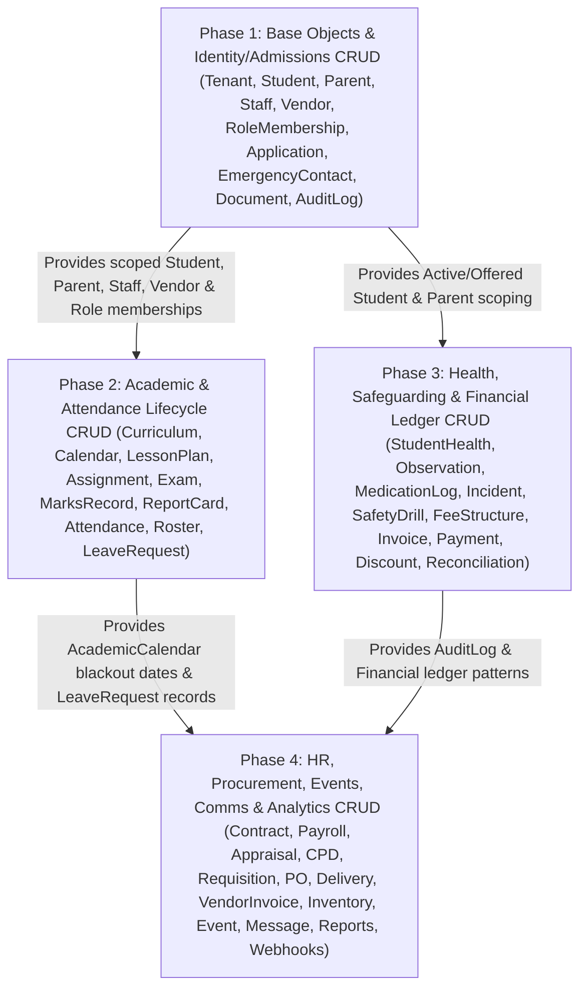

# Technical Execution Plan: Complete CRUD & ICD Coverage (`9_CRUD_EXECUTION_PLAN.md`)

**Document Status:** Active Technical Execution Roadmap  
**Last Updated:** 2026-10-31  
**Author:** Software Development Lead (`SDL_SB`)  
**Aligned Sources:** [`AGENTS.md`](file:///Users/soumyadeepbhadra/My%20Files/BusinessInCanada/School%20CRM/skool_crm/AGENTS.md), [`docs/8_PRODUCT_BACKLOG_STORIES.md`](file:///Users/soumyadeepbhadra/My%20Files/BusinessInCanada/School%20CRM/skool_crm/docs/8_PRODUCT_BACKLOG_STORIES.md), [`docs/rule_registry.md`](file:///Users/soumyadeepbhadra/My%20Files/BusinessInCanada/School%20CRM/skool_crm/docs/rule_registry.md), [`docs/3_ARCHITECTURE.md`](file:///Users/soumyadeepbhadra/My%20Files/BusinessInCanada/School%20CRM/skool_crm/docs/3_ARCHITECTURE.md), [`docs/1_SECURITY.md`](file:///Users/soumyadeepbhadra/My%20Files/BusinessInCanada/School%20CRM/skool_crm/docs/1_SECURITY.md)

---

## 1. Executive Summary & Architectural Mandate

This document translates the full-stack CRUD audit across all **7 Base Objects** and **35 Derived Objects** in [`core/models.py`](file:///Users/soumyadeepbhadra/My%20Files/BusinessInCanada/School%20CRM/skool_crm/core/models.py) into an actionable, dependency-sequenced **Technical Execution Plan** and **Interface Control Document (ICD) Matrix**.

While initial sprints prioritized vertical workflow endpoints (such as admission state transitions, bulk attendance marking, and Stripe checkout initiation), operational portals (`US-P2-01` through `US-P2-08`) and core domain epics (`US-P0-03` through `US-P3-04`) require complete, consistent **Create, Read (List/Detail), Update, and Soft-Delete (CRUD)** capabilities across all domain resources—strictly governed by the platform's 3-layer architecture (`core/schemas/` $\rightarrow$ `core/business_objects/` $\rightarrow$ `core/api/v1/`) and Class 2 Business Rules (`BR-01-01` through `BR-09-01`).

### Summary of Scope by Delivery Phase

| Phase | Sprint Focus | Target Domains & Entities | Backlog Alignment | Existing Endpoints | New CRUD Endpoints | Total Target ICDs |
| :--- | :--- | :--- | :--- | :---: | :---: | :---: |
| **Phase 1** | **Base Objects & Identity/Admissions CRUD** | `Tenant`, `Student`, `Parent`, `Staff`, `Vendor`, `PortalRoleMembership`, `Application`, `EmergencyContact`, `Document`, `AuditLog` | `US-P0-01`..`04`, `US-P1-03`, `US-P1-08` | 24 | 27 | **51** |
| **Phase 2** | **Academic & Attendance Lifecycle CRUD** | `Curriculum`, `AcademicCalendar`, `LessonPlan`, `Assignment`, `Exam`, `MarksRecord`, `ReportCard`, `StudentAttendance`, `StaffAttendance`, `AttendanceRoster`, `LeaveRequest` | `US-P1-01`..`04`, `US-P2-02`, `US-P2-03` | 15 | 31 | **46** |
| **Phase 3** | **Health, Safeguarding & Financial Ledger CRUD** | `StudentHealth`, `HealthObservation`, `MedicationLog`, `Incident`, `SafetyDrill`, `FeeStructure`, `Invoice`, `Payment`, `DiscountWaiver`, `Reconciliation` | `US-P1-05`..`07`, `US-P2-04`, `US-P2-05` | 17 | 21 | **38** |
| **Phase 4** | **HR, Procurement, Events, Comms & Analytics CRUD** | `Contract`, `PayrollRun`, `Appraisal`, `CPDRecord`, `Requisition`, `PurchaseOrder`, `DeliveryRecord`, `VendorInvoice`, `Inventory`, `Event`, `EventRegistration`, `EventVolunteer`, `EventReport`, `Message`, `NotificationRule`, `CustomReport`, `ReportSchedule`, `WebhookSubscription`, `WebhookDeliveryAttempt` | `US-P1-08`..`10`, `US-P2-06`..`08`, `US-P3-01`..`04` | 21 | 48 | **69** |
| **Total** | **4 Sequenced Execution Phases** | **7 Base Objects + 35 Derived Objects** | **All P0–P3 Epics** | **77** | **127** | **204** |

---

## 2. Architectural & Compliance Guardrails for CRUD Operations

Every CRUD endpoint implemented under this plan must strictly enforce the following six architectural invariants:

### 2.1 Strict 3-Layer Split (`Schema -> BO -> Route`)
1. **Payload Schemas (`core/schemas/<domain>.py`):** Every `POST`, `PUT`, and `PATCH` route must validate request payloads through explicit Django Ninja `Schema` classes (`*CreateInput`, `*UpdateInput`, `*FilterSchema`). Partial updates (`PATCH`) must define optional fields with `None` defaults and reject mass-assignment of protected columns (`id`, `tenant_id`, `is_deleted`, `created_at`).
2. **Business Object Layer (`core/business_objects/<domain>.py`):** Route handlers must **never** mutate models with domain invariants directly. All state mutations, cross-entity validations, and Class 2 Business Rules (`BR-xx-xx`) must execute inside `@transaction.atomic` BO methods raising `RuleViolation(rule="BR-xx-xx", message="...")` (HTTP 422 `RULE_VIOLATION`).
3. **HTTP Route Layer (`core/api/v1/<domain>.py`):** Authenticate via `auth=JWTAuthBearer()`, authorize via `@require_roles([...])` and object-level guards in [`core/auth/scoping.py`](file:///Users/soumyadeepbhadra/My%20Files/BusinessInCanada/School%20CRM/skool_crm/core/auth/scoping.py), and return standardized `build_response(data=..., status=...)` / `build_error(...)` envelopes.

### 2.2 Multi-Tenant & Object-Level Scoping (`Never Rule #2`)
- **Mandatory Tenant & Soft-Delete Filter:** Every ORM query must include `.filter(tenant_id=request.tenant_id, is_deleted=False)` or use `get_object_or_404(Model, id=..., tenant_id=request.tenant_id, is_deleted=False)`.
- **PostgreSQL RLS Context:** All queries execute under active `app.current_tenant_id` session state (`0020_enable_tenant_rls`).
- **Role & Object-Level Guards (`core/auth/scoping.py`):**
  - **Student-linked resources:** Enforce `get_student_queryset(request)` on list endpoints and `verify_student_access(request, student)` on detail/create/update/delete endpoints (`Teacher` scoped to assigned classes, `Caregiver` scoped to assigned care groups, `Parent` scoped to linked children).
  - **Application-linked resources:** Enforce `verify_application_access(request, application)`.
  - **Vendor-linked resources:** Enforce `verify_vendor_access(request, vendor)`.
  - **Staff self-service resources:** Enforce self-scope when accessed by `Staff` or `Teacher` roles for personal leaves, appraisals, CPD records, or payslips.
  - **Governance roles (`Board`, `Trustee`):** Strictly blocked (HTTP 403) from all individual student, parent, staff, and health CRUD endpoints; permitted only on anonymized aggregate endpoints (`US-P2-07`).

### 2.3 Soft Deletion vs. Immutable Audit Records
Hard `Model.delete()` calls are **strictly forbidden** across all tenant-scoped tables. Deletion semantics are partitioned into three compliance classes:

| Deletion / Mutation Class | Target Entities | Enforcement Mechanism & Compliance Rule |
| :--- | :--- | :--- |
| **Class A: Strictly Immutable (No Update / No Delete)** | `AuditLog`, signed-off `SafetyDrill` (`BR-07-04`), `WebhookDeliveryAttempt`, `AnalyticsSnapshot` | `PUT`, `PATCH`, and `DELETE` endpoints are omitted or return HTTP 405/422. Corrections to a signed-off `SafetyDrill` require creating a new superseding drill record (`BR-07-04`). |
| **Class B: State-Locked / Approval-Gated Mutation & Reversal** | `Application` (`BR-01-04`), `MarksRecord` (`BR-04-07`), `ReportCard` (`BR-04-04`..`06`), `StudentAttendance` (`BR-03-01`), `Invoice` (`BR-02-01`, `BR-02-05`), `Payment` (`BR-02-04`), `DiscountWaiver` (`BR-02-03`, `BR-02-04`), `Reconciliation` (`BR-02-06`), `PayrollRun`, `VendorInvoice` (`BR-08-01`) | Financial ledger items (`Invoice`, `Payment`, `DiscountWaiver`, `PayrollRun`, `VendorInvoice`) **cannot be deleted** once issued/posted; they transition via controlled reversal states (`Cancelled`, `Refunded`, `Rejected`) with mandatory `AuditLog` entries. `StudentAttendance` edits/soft-deletes after 24h require `Principal` override (`BR-03-01`). Locked `MarksRecord` edits require `Principal`/`Owner` approval + `audit_note` (`BR-04-07`). |
| **Class C: Standard Soft-Delete (`is_deleted=True`)** | `Student`, `Parent`, `Staff`, `Vendor`, `PortalRoleMembership`, `EmergencyContact`, unverified `Document`, `Curriculum`, `AcademicCalendar`, `LessonPlan`, `Assignment`, `Exam`, pending `LeaveRequest`, `HealthObservation`, `FeeStructure`, draft `Contract`, `CPDRecord`, draft `Requisition`, `Inventory`, `Event`, `EventRegistration`, `EventVolunteer`, `NotificationRule`, `CustomReport`, `ReportSchedule`, `WebhookSubscription` | `DELETE` endpoints execute via BO soft-delete helper setting `is_deleted=True` (and `status='Inactive'` where applicable), recording an `AuditLog` entry with actor ID, timestamp, and reason, while checking referential guards (e.g., cannot soft-delete a `Student` with open unpaid `Invoice` balances per `BR-02-01` or last `EmergencyContact` of an `Active` student per `BR-01-03`). |

---

## 3. Target Interface Control Document (ICD) Matrix — Base Objects

Legend for **Status**:
- `PRESENT` — Implemented in `core/api/v1/` (verify scoping & regression tests).
- `NEW` — Missing CRUD endpoint to be implemented in this execution plan.

### 3.1 Base Objects (`Tenant`, `Student`, `Parent`, `Staff`, `Vendor`, `PortalRoleMembership`, `TenantSequence`)

| Object | CRUD | Status | HTTP Method & Path | Allowed Roles (`@require_roles`) | Schema Class (`core/schemas/`) | Business Object & Method (`core/business_objects/`) | Business Rules & Scoping Guards |
| :--- | :---: | :---: | :--- | :--- | :--- | :--- | :--- |
| **`Tenant`** | **C** | `PRESENT` | `POST /api/v1/auth/trial-signup` | Public (Unauthenticated) | `TrialSignupInput` (`auth.py`) | `TrialSignupBO.create_trial()` | Atomic tenant + role membership creation |
| **`Tenant`** | **R** | `PRESENT` | `GET /api/v1/school-setup/config` | `Admin`, `Principal`, `Owner` | `SchoolConfigOutput` (`school_setup.py`) | Direct read (`request.tenant_id`) | Scoped to `Tenant.id == request.tenant_id` |
| **`Tenant`** | **U** | `NEW` | `PATCH /api/v1/school-setup/config` | `Admin`, `Owner` | `TenantConfigUpdateInput` (`school_setup.py`) | `SchoolSetupBO.update_tenant_config()` | Updates school profile, grace period, thresholds; logs `AuditLog` |
| **`Tenant`** | **D** | `NEW` | `POST /api/v1/school-setup/deactivate` | `Owner` | `TenantDeactivateInput` (`school_setup.py`) | `SchoolSetupBO.deactivate_tenant()` | Soft-deactivates tenant; blocks if active billing lock |
| **`Student`** | **C** | `PRESENT` | `POST /api/v1/enrollments` & `POST /api/v1/school-setup/import` | `Parent`, `Admin`, `Principal`, `Owner` | `EnrollmentCreateSchema` (`enrollment.py`) | `EnrollmentCaseBO.create_enrollment()` / `SchoolSetupImportBO` | `BR-01-05` atomic `STU-YYYY-XXXX` via `TenantSequence` |
| **`Student`** | **C** | `NEW` | `POST /api/v1/students` | `Admin`, `Principal`, `Owner` | `StudentCreateInput` (`enrollment.py`) | `StudentProfileBO.create_direct_student()` | `BR-01-05` (`student_number`); requires valid `parent_id` in tenant |
| **`Student`** | **R** | `PRESENT` | `GET /api/v1/students` | `Admin`, `Principal`, `Vice_Principal`, `Teacher`, `CareGiver`, `Parent`, `Owner` | `StudentListFilterSchema` (`enrollment.py`) | `get_student_queryset(request)` | **Priority #1 (`US-P1-03`):** Enforce Teacher class & Caregiver group filter |
| **`Student`** | **R** | `PRESENT` | `GET /api/v1/students/{student_id}` & `/profile` | `Admin`, `Principal`, `Vice_Principal`, `Teacher`, `CareGiver`, `Parent`, `Owner` | `StudentProfileOutput` (`enrollment.py`) | `StudentProfileBO` | `verify_student_access(request, student)` |
| **`Student`** | **R** | `PRESENT` | `GET /api/v1/students/aggregate` | `Admin`, `Principal`, `Owner`, `Board`, `Trustee` | `StudentAggregateOutput` (`enrollment.py`) | `StudentProfileBO` | Anonymized counts only (`US-P2-07`) |
| **`Student`** | **U** | `PRESENT` | `PATCH /api/v1/students/{student_id}` | `Admin`, `Principal`, `Vice_Principal`, `Teacher`, `Owner` | `StudentUpdateSchema` (`enrollment.py`) | `StudentProfileBO.update_student()` | `BR-01-02`, `BR-01-03` if transitioning `status` to `Active` |
| **`Student`** | **D** | `NEW` | `DELETE /api/v1/students/{student_id}` | `Admin`, `Owner` | — | `StudentProfileBO.soft_delete_student()` | Sets `is_deleted=True, status='Inactive'`; blocks if open unpaid `Invoice` (`BR-02-01`) |
| **`Parent`** | **C** | `NEW` | `POST /api/v1/parents` | `Admin`, `Principal`, `Owner` | `ParentCreateInput` (`enrollment.py`) | `StudentProfileBO.create_parent()` | Tenant-scoped parent creation; `AuditLog` |
| **`Parent`** | **R** | `NEW` | `GET /api/v1/parents` | `Admin`, `Principal`, `Vice_Principal`, `Owner` | `ParentFilterSchema` (`enrollment.py`) | `StudentProfileBO.list_parents()` | Scoped to `tenant_id=request.tenant_id, is_deleted=False` |
| **`Parent`** | **R** | `NEW` | `GET /api/v1/parents/{parent_id}` | `Admin`, `Principal`, `Vice_Principal`, `Parent`, `Owner` | `ParentDetailOutput` (`enrollment.py`) | `StudentProfileBO.get_parent()` | Parent role restricted to own record |
| **`Parent`** | **U** | `NEW` | `PATCH /api/v1/parents/{parent_id}` | `Admin`, `Principal`, `Parent`, `Owner` | `ParentUpdateInput` (`enrollment.py`) | `StudentProfileBO.update_parent()` | Self-service contact update allowed for linked `Parent` |
| **`Parent`** | **D** | `NEW` | `DELETE /api/v1/parents/{parent_id}` | `Admin`, `Owner` | — | `StudentProfileBO.soft_delete_parent()` | Blocks soft-delete if linked to any `Active` `Student` without secondary guardian |
| **`Staff`** | **C** | `PRESENT` | `POST /api/v1/staff` | `Admin`, `Principal`, `Owner` | `StaffCreateSchema` (`sprint5.py`) | `StaffMemberBO.create_staff()` | `BR-05-01` (valid DBS check required for teaching role) |
| **`Staff`** | **R** | `NEW` | `GET /api/v1/staff` | `Admin`, `Principal`, `Vice_Principal`, `Owner` | `StaffFilterSchema` (`sprint5.py`) | `StaffMemberBO.list_staff()` | Filters by `role`, `dept`, `active`, `dbs_valid` |
| **`Staff`** | **R** | `PRESENT` | `GET /api/v1/staff/{staff_id}` & `/compliance-status` | `Admin`, `Principal`, `Vice_Principal`, `Owner`, `Staff` (self) | `StaffDetailOutput` (`sprint5.py`) | `StaffMemberBO.compliance_status()` | `BR-05-01`; `Staff` role restricted to own record (`US-P2-08`) |
| **`Staff`** | **U** | `NEW` | `PATCH /api/v1/staff/{staff_id}` | `Admin`, `Principal`, `Owner` | `StaffUpdateInput` (`sprint5.py`) | `StaffMemberBO.update_staff()` | Enforces `BR-05-01` on teaching duty/class assignment changes |
| **`Staff`** | **D** | `NEW` | `DELETE /api/v1/staff/{staff_id}` | `Admin`, `Owner` | — | `StaffMemberBO.deactivate_staff()` | Sets `is_deleted=True, active=False`, revokes active `PortalRoleMembership` |
| **`Vendor`** | **C** | `PRESENT` | `POST /api/v1/vendors` | `Admin`, `Principal`, `Owner` | `VendorCreateSchema` (`sprint5.py`) | `VendorAccountBO.create_vendor()` | Tenant-scoped vendor onboarding |
| **`Vendor`** | **R** | `NEW` | `GET /api/v1/vendors` | `Admin`, `Principal`, `Owner`, `Staff` | `VendorFilterSchema` (`sprint5.py`) | `VendorAccountBO.list_vendors()` | Scoped to `tenant_id=request.tenant_id, is_deleted=False` |
| **`Vendor`** | **R** | `PRESENT` | `GET /api/v1/vendors/{vendor_id}/account` | `Admin`, `Principal`, `Owner`, `Vendor` | `VendorAccountOutput` (`sprint5.py`) | `VendorAccountBO.summary()` | `verify_vendor_access(request, vendor)` (`US-P2-06`) |
| **`Vendor`** | **U** | `NEW` | `PATCH /api/v1/vendors/{vendor_id}` | `Admin`, `Owner`, `Vendor` (self contact info) | `VendorUpdateInput` (`sprint5.py`) | `VendorAccountBO.update_vendor()` | `verify_vendor_access`; only `Admin`/`Owner` can alter `active` status |
| **`Vendor`** | **D** | `NEW` | `DELETE /api/v1/vendors/{vendor_id}` | `Admin`, `Owner` | — | `VendorAccountBO.soft_delete_vendor()` | Blocks if open `PurchaseOrder` or unpaid `VendorInvoice` exists |
| **`PortalRoleMembership`** | **C** | `NEW` | `POST /api/v1/role-memberships` | `Admin`, `Owner` | `RoleMembershipCreateInput` (`auth.py`) | `RoleMembershipBO.assign_role()` | Only `Owner` can grant `Owner` role; enforces tenant isolation |
| **`PortalRoleMembership`** | **R** | `NEW` | `GET /api/v1/role-memberships` | `Admin`, `Principal`, `Owner` | `RoleMembershipFilterSchema` (`auth.py`) | `RoleMembershipBO.list_memberships()` | Lists user-to-role bindings in `request.tenant_id` |
| **`PortalRoleMembership`** | **U** | `NEW` | `PATCH /api/v1/role-memberships/{membership_id}` | `Admin`, `Owner` | `RoleMembershipUpdateInput` (`auth.py`) | `RoleMembershipBO.update_membership()` | Updates `is_active` or assigned classes/care-groups (`US-P1-03`, `US-P1-08`) |
| **`PortalRoleMembership`** | **D** | `NEW` | `DELETE /api/v1/role-memberships/{membership_id}` | `Admin`, `Owner` | — | `RoleMembershipBO.revoke_membership()` | Deactivates membership; blocks revoking the last active `Owner` in tenant |
| **`TenantSequence`** | **R** | `NEW` | `GET /api/v1/school-setup/sequences` | `Admin`, `Owner` | `TenantSequenceOutput` (`school_setup.py`) | `SchoolSetupBO.list_sequences()` | Read-only diagnostic view of `student_number` / `invoice` counters (`BR-01-05`); mutations remain strictly internal |

---

## 4. Target Interface Control Document (ICD) Matrix — Derived Objects

### 4.1 Admissions, Student Records & System Audit (`core/api/v1/enrollments.py`, `core/api/v1/school_setup.py`)

| Object | CRUD | Status | HTTP Method & Path | Allowed Roles (`@require_roles`) | Schema Class (`core/schemas/`) | Business Object & Method (`core/business_objects/`) | Business Rules & Scoping Guards |
| :--- | :---: | :---: | :--- | :--- | :--- | :--- | :--- |
| **`Application`** | **C** | `PRESENT` | `POST /api/v1/enrollments` | `Parent`, `Admin` | `EnrollmentCreateSchema` (`enrollment.py`) | `EnrollmentCaseBO.create_enrollment()` | `BR-01-05` student number generation |
| **`Application`** | **R** | `PRESENT` | `GET /api/v1/enrollments/pipeline`, `/my-applications`, `/{application_id}/status` | `Admin`, `Principal`, `Vice_Principal`, `Owner`, `Parent` (own) | `ApplicationOutput` (`enrollment.py`) | `EnrollmentCaseBO` | `verify_application_access(request, app)` |
| **`Application`** | **U** | `PRESENT` | `PATCH /api/v1/enrollments/{application_id}`, `/submit`, `/decision`, `/accept-offer`, `/assessment*`, `/recommendation` | `Parent` (draft/submit/accept), `Admin`, `Principal`, `Vice_Principal`, `Teacher` (assess), `Owner` | `EnrollmentDraftUpdateSchema`, `EnrollmentDecisionSchema` (`enrollment.py`) | `EnrollmentCaseBO.advance_status()` | `BR-01-01` (docs verified), `BR-01-02` (seat payment), `BR-01-03` (emergency contact), `BR-01-04` (decision immutability after dispatch) |
| **`Application`** | **D** | `NEW` | `DELETE /api/v1/enrollments/{application_id}` | `Parent` (draft only), `Admin`, `Owner` | — | `EnrollmentCaseBO.withdraw_application()` | Soft-deletes / withdraws; blocked if `notification_dispatched=True` unless `Owner` (`BR-01-04`) |
| **`EmergencyContact`** | **C** | `NEW` | `POST /api/v1/students/{student_id}/emergency-contacts` | `Admin`, `Principal`, `Parent`, `Owner` | `EmergencyContactCreateInput` (`enrollment.py`) | `StudentProfileBO.add_emergency_contact()` | `verify_student_access`; satisfies `BR-01-03` |
| **`EmergencyContact`** | **R** | `NEW` | `GET /api/v1/students/{student_id}/emergency-contacts` | `Admin`, `Principal`, `Vice_Principal`, `Teacher`, `CareGiver`, `Parent`, `Owner` | `EmergencyContactOutput` (`enrollment.py`) | `StudentProfileBO.list_emergency_contacts()` | `verify_student_access(request, student)` |
| **`EmergencyContact`** | **U** | `NEW` | `PATCH /api/v1/emergency-contacts/{contact_id}` | `Admin`, `Principal`, `Parent`, `Owner` | `EmergencyContactUpdateInput` (`enrollment.py`) | `StudentProfileBO.update_emergency_contact()` | `verify_student_access(request, contact.student)` |
| **`EmergencyContact`** | **D** | `NEW` | `DELETE /api/v1/emergency-contacts/{contact_id}` | `Admin`, `Principal`, `Parent`, `Owner` | — | `StudentProfileBO.delete_emergency_contact()` | **Enforces `BR-01-03`:** Rejects with HTTP 422 if deleting the last active emergency contact of an `Active` student |
| **`Document`** | **C** | `PRESENT` | `POST /api/v1/enrollments/{application_id}/documents`, `/upload`, `POST /api/v1/students/{student_id}/documents` | `Parent`, `Admin`, `Principal`, `Vice_Principal`, `Owner` | `DocumentUploadSchema` (`enrollment.py`) | `EnrollmentCaseBO.upload_document()` | `verify_application_access` / `verify_student_access` |
| **`Document`** | **R** | `NEW` | `GET /api/v1/enrollments/{application_id}/documents` | `Parent`, `Admin`, `Principal`, `Vice_Principal`, `Owner` | `DocumentMetadataOutput` (`enrollment.py`) | `EnrollmentCaseBO.list_documents()` | Lists required/uploaded doc statuses for `BR-01-01` checklist |
| **`Document`** | **R** | `PRESENT` | `GET /api/v1/enrollments/{application_id}/documents/{document_id}/view` | `Admin`, `Principal`, `Owner` | — | File stream | Streams uploaded document |
| **`Document`** | **U** | `PRESENT` | `PUT /api/v1/enrollments/{application_id}/documents/{document_id}/verify` | `Admin`, `Principal`, `Owner` | `DocumentVerifySchema` (`enrollment.py`) | `EnrollmentCaseBO.verify_document()` | Marks document verified (`BR-01-01`) |
| **`Document`** | **D** | `NEW` | `DELETE /api/v1/enrollments/{application_id}/documents/{document_id}` | `Parent` (unverified only), `Admin`, `Owner` | — | `EnrollmentCaseBO.delete_document()` | Blocks deleting verified required documents if application is `>= Offered` (`BR-01-01`) |
| **`AuditLog`** | **R** | `NEW` | `GET /api/v1/audit-logs` | `Admin`, `Owner` | `AuditLogFilterSchema` (`school_setup.py`) | `SchoolSetupBO.list_audit_logs()` | **Append-Only Compliance (`BR-02-04`, `BR-04-07`):** Read-only filter by `entity`, `actor_id`, `action`, date range; C/U/D via REST strictly forbidden |

### 4.2 Academics (`core/api/v1/academics.py`)

| Object | CRUD | Status | HTTP Method & Path | Allowed Roles (`@require_roles`) | Schema Class (`core/schemas/academic.py`) | Business Object & Method (`core/business_objects/academic.py`) | Business Rules & Scoping Guards |
| :--- | :---: | :---: | :--- | :--- | :--- | :--- | :--- |
| **`Curriculum`** | **C** | `NEW` | `POST /api/v1/curriculums` | `Admin`, `Principal`, `Owner` | `CurriculumCreateInput` | `ClassroomPlanBO.create_curriculum()` | Defines valid topics/outcomes for `BR-04-01` |
| **`Curriculum`** | **R** | `NEW` | `GET /api/v1/curriculums` & `GET /api/v1/curriculums/{curriculum_id}` | `Admin`, `Principal`, `Vice_Principal`, `Teacher`, `Owner` | `CurriculumOutput` | `ClassroomPlanBO.list_curriculums()` | Scoped to `request.tenant_id, is_deleted=False` |
| **`Curriculum`** | **U** | `NEW` | `PATCH /api/v1/curriculums/{curriculum_id}` | `Admin`, `Principal`, `Owner` | `CurriculumUpdateInput` | `ClassroomPlanBO.update_curriculum()` | Preserves topic IDs referenced by active `LessonPlan` records (`BR-04-01`) |
| **`Curriculum`** | **D** | `NEW` | `DELETE /api/v1/curriculums/{curriculum_id}` | `Admin`, `Principal`, `Owner` | — | `ClassroomPlanBO.delete_curriculum()` | Soft-deletes; blocks if referenced by active term `LessonPlan` |
| **`AcademicCalendar`** | **C** | `NEW` | `POST /api/v1/calendars` | `Admin`, `Principal`, `Owner` | `AcademicCalendarCreateInput` | `AcademicCalendarBO.create_calendar()` | Configures holidays, blackout dates, exam weeks |
| **`AcademicCalendar`** | **R** | `PRESENT` | `GET /api/v1/calendar/current` | All authenticated school roles + `Parent` | `AcademicCalendarOutput` | `AcademicCalendarBO` | Returns active calendar for tenant |
| **`AcademicCalendar`** | **R** | `NEW` | `GET /api/v1/calendars` & `GET /api/v1/calendars/{calendar_id}` | `Admin`, `Principal`, `Vice_Principal`, `Teacher`, `Parent`, `Owner` | `AcademicCalendarOutput` | `AcademicCalendarBO.list_calendars()` | Lists all academic years/term calendars in tenant |
| **`AcademicCalendar`** | **U** | `NEW` | `PATCH /api/v1/calendars/{calendar_id}` | `Admin`, `Principal`, `Owner` | `AcademicCalendarUpdateInput` | `AcademicCalendarBO.update_calendar()` | Updates holidays/blackout dates (`BR-03-04`, `BR-04-02`, `BR-04-03`, `BR-04-05`) |
| **`AcademicCalendar`** | **D** | `NEW` | `DELETE /api/v1/calendars/{calendar_id}` | `Admin`, `Owner` | — | `AcademicCalendarBO.delete_calendar()` | Blocks soft-deleting the currently active calendar |
| **`LessonPlan`** | **C** | `PRESENT` | `POST /api/v1/lesson-plans` | `Teacher`, `Principal`, `Admin` | `LessonPlanCreateSchema` | `ClassroomPlanBO.create_lesson_plan()` | **Enforces `BR-04-01`:** Must map to valid topic/outcome in active `Curriculum` |
| **`LessonPlan`** | **R** | `PRESENT` | `GET /api/v1/classes/{class_id}/plan/{week}` | `Teacher`, `Principal`, `Vice_Principal`, `Admin`, `Parent` | `LessonPlanOutput` | `ClassroomPlanBO` | Scoped to class/week |
| **`LessonPlan`** | **R** | `NEW` | `GET /api/v1/lesson-plans` | `Teacher`, `Principal`, `Vice_Principal`, `Admin` | `LessonPlanFilterSchema` | `ClassroomPlanBO.list_lesson_plans()` | Teachers scoped to assigned classes (`US-P2-03`) |
| **`LessonPlan`** | **U** | `NEW` | `PATCH /api/v1/lesson-plans/{plan_id}` | `Teacher`, `Principal`, `Vice_Principal`, `Admin` | `LessonPlanUpdateInput` | `ClassroomPlanBO.update_lesson_plan()` | Re-validates `BR-04-01` if curriculum topic changes |
| **`LessonPlan`** | **D** | `NEW` | `DELETE /api/v1/lesson-plans/{plan_id}` | `Teacher` (own draft), `Principal`, `Admin` | — | `ClassroomPlanBO.delete_lesson_plan()` | Soft-deletes (`is_deleted=True`) |
| **`Assignment`** | **C** | `PRESENT` | `POST /api/v1/assignments` | `Teacher`, `Principal`, `Admin` | `AssignmentCreateSchema` | `ClassroomPlanBO.create_assignment()` | **Enforces `BR-04-02`:** Due date cannot fall on holiday/blackout date |
| **`Assignment`** | **R** | `NEW` | `GET /api/v1/assignments` & `GET /api/v1/assignments/{assignment_id}` | `Teacher`, `Principal`, `Vice_Principal`, `Admin`, `Parent` | `AssignmentFilterSchema`, `AssignmentOutput` | `ClassroomPlanBO.list_assignments()` | Parents see only linked child's class assignments; Teachers see assigned classes |
| **`Assignment`** | **U** | `NEW` | `PATCH /api/v1/assignments/{assignment_id}` | `Teacher`, `Principal`, `Vice_Principal`, `Admin` | `AssignmentUpdateInput` | `ClassroomPlanBO.update_assignment()` | **Enforces `BR-04-02`:** Rejects updating `due_date` to a holiday/blackout date |
| **`Assignment`** | **D** | `NEW` | `DELETE /api/v1/assignments/{assignment_id}` | `Teacher`, `Principal`, `Admin` | — | `ClassroomPlanBO.delete_assignment()` | Soft-deletes (`is_deleted=True`) |
| **`Exam`** | **C** | `PRESENT` | `POST /api/v1/exams` | `Admin`, `Principal`, `Vice_Principal` | `ExamCreateSchema` | `ExamPackageBO.create_exam()` | **Enforces `BR-04-03`:** Rejects holiday/blackout date or same-class time overlap |
| **`Exam`** | **R** | `PRESENT` | `GET /api/v1/exams/{exam_id}/hall-tickets` | `Admin`, `Principal`, `Teacher`, `Staff` | `HallTicketOutput` | `ExamPackageBO.generate_hall_tickets()` | Scoped to eligible students |
| **`Exam`** | **R** | `NEW` | `GET /api/v1/exams` & `GET /api/v1/exams/{exam_id}` | `Admin`, `Principal`, `Vice_Principal`, `Teacher`, `Parent` | `ExamFilterSchema`, `ExamOutput` | `ExamPackageBO.list_exams()` | Filters by `class_id`, `date` |
| **`Exam`** | **U** | `NEW` | `PATCH /api/v1/exams/{exam_id}` | `Admin`, `Principal`, `Vice_Principal` | `ExamUpdateInput` | `ExamPackageBO.update_exam()` | **Enforces `BR-04-03`:** Re-checks holiday & time-slot overlap (excluding `exam_id` itself) |
| **`Exam`** | **D** | `NEW` | `DELETE /api/v1/exams/{exam_id}` | `Admin`, `Principal` | — | `ExamPackageBO.delete_exam()` | Blocks soft-delete if locked/moderated `MarksRecord` entries exist (`BR-04-07`) |
| **`MarksRecord`** | **C/U** | `PRESENT` | `POST /api/v1/exams/{exam_id}/marks` | `Teacher`, `Principal`, `Admin` | `MarksEntrySchema` | `AcademicRecordBO.record_marks()` | **Enforces `BR-04-07`:** Blocks post-lock edits unless `Principal`/`Owner` + audit log |
| **`MarksRecord`** | **R** | `NEW` | `GET /api/v1/exams/{exam_id}/marks` | `Teacher`, `Principal`, `Vice_Principal`, `Admin`, `Owner` | `MarksRecordOutput` | `AcademicRecordBO.list_exam_marks()` | Teachers scoped to assigned classes (`US-P1-02`, `US-P2-03`) |
| **`MarksRecord`** | **U** | `NEW` | `PATCH /api/v1/marks/{marks_id}` | `Teacher`, `Principal`, `Vice_Principal`, `Owner` | `MarksUpdateInput` | `AcademicRecordBO.update_marks_record()` | **Enforces `BR-04-04` & `BR-04-07`:** Moderator sign-off & post-lock override with `AuditLog` |
| **`ReportCard`** | **C** | `NEW` | `POST /api/v1/academic-records` | `Teacher`, `Principal`, `Vice_Principal`, `Admin` | `ReportCardGenerateSchema` | `AcademicRecordBO.create_draft_report_card()` | Aggregates term `MarksRecord` entries into a draft `ReportCard` |
| **`ReportCard`** | **R** | `PRESENT` | `GET /api/v1/students/{student_id}/academic-record/{term}` | `Admin`, `Principal`, `Vice_Principal`, `Teacher`, `Parent`, `Owner` | `ReportCardOutput` | `AcademicRecordBO` | `verify_student_access`; **Parents restricted to `is_published=True` (`US-P1-02`)** |
| **`ReportCard`** | **U** | `NEW` | `PATCH /api/v1/academic-records/{report_id}` | `Teacher` (draft), `Principal`, `Vice_Principal`, `Owner` | `ReportCardUpdateInput` | `AcademicRecordBO.update_report_card()` | Allows moderation sign-off (`BR-04-04`) and counselor/principal attendance override (`BR-04-06`) |
| **`ReportCard`** | **U** | `PRESENT` | `POST /api/v1/academic-records/{report_id}/publish` | `Principal`, `Vice_Principal`, `Admin`, `Owner` | — | `AcademicRecordBO.publish()` | **Enforces `BR-04-04` (moderated), `BR-04-05` (`>= published_date`), `BR-04-06` (`>= 75%` attendance)** |

### 4.3 Attendance & Leave Management (`core/api/v1/attendance.py`)

| Object | CRUD | Status | HTTP Method & Path | Allowed Roles (`@require_roles`) | Schema Class (`core/schemas/attendance_health.py`) | Business Object & Method (`core/business_objects/attendance_health.py`) | Business Rules & Scoping Guards |
| :--- | :---: | :---: | :--- | :--- | :--- | :--- | :--- |
| **`StudentAttendance`** | **C** | `PRESENT` | `POST /api/v1/attendance/mark` & `/bulk-mark` | `Teacher`, `CareGiver`, `Admin`, `Principal`, `Owner` | `AttendanceMarkSchema`, `AttendanceRosterBulkMarkSchema` | `AttendanceSheetBO.mark_attendance()`, `.mark_roster()` | `verify_student_access`; **Enforces `BR-03-01` (24h lock), `BR-03-02` (unexcused alert), `BR-03-05` (`< 80%` flag)** |
| **`StudentAttendance`** | **R** | `PRESENT` | `GET /api/v1/attendance/students/{att_date}`, `/classes/{class_id}/attendance/{att_date}`, `/students/{student_id}/attendance-summary`, `/attendance/reports/{report_type}` | `Teacher`, `CareGiver`, `Admin`, `Principal`, `Vice_Principal`, `Parent` (summary only), `Owner` | `AttendanceOutput` | `AttendanceSheetBO.compute_student_summary()` | Strictly scoped via `get_student_queryset(request)` and `verify_student_access` (`US-P1-03`) |
| **`StudentAttendance`** | **U** | `PRESENT` | `PATCH /api/v1/attendance/{att_id}` | `Teacher`, `CareGiver`, `Admin`, `Principal`, `Vice_Principal`, `Owner` | `AttendanceUpdateSchema` | `AttendanceSheetBO.update_record()` | **Enforces `BR-03-01`:** Blocks edits `> 24h` after session date unless actor is `Principal` |
| **`StudentAttendance`** | **D** | `NEW` | `DELETE /api/v1/attendance/{att_id}` | `Teacher`, `Admin`, `Principal` | — | `AttendanceSheetBO.delete_attendance()` | **Enforces `BR-03-01`:** Soft-deletes duplicate/erroneous entry within 24h (or `Principal` override with `AuditLog`) |
| **`StaffAttendance`** | **C** | `NEW` | `POST /api/v1/staff/attendance` | `Admin`, `Principal`, `Vice_Principal` | `StaffAttendanceCreateInput` | `StaffRosterBO.mark_staff_attendance()` | **Enforces `BR-03-03`:** Unexcused staff absence triggers immediate class-without-cover alert to `Vice_Principal` |
| **`StaffAttendance`** | **R** | `NEW` | `GET /api/v1/staff/attendance` | `Admin`, `Principal`, `Vice_Principal`, `Owner`, `Staff` (self) | `StaffAttendanceFilterSchema` | `StaffRosterBO.list_staff_attendance()` | Filters by `date`, `staff_id`, `status` |
| **`StaffAttendance`** | **U** | `NEW` | `PATCH /api/v1/staff/attendance/{staff_att_id}` | `Admin`, `Principal`, `Vice_Principal` | `StaffAttendanceUpdateInput` | `StaffRosterBO.update_staff_attendance()` | Re-evaluates `BR-03-03` cover alert state |
| **`AttendanceRoster`** | **C** | `NEW` | `POST /api/v1/attendance/rosters` | `Admin`, `Principal`, `Vice_Principal` | `AttendanceRosterCreateInput` | `StaffRosterBO.create_roster()` | Assigns daily class/duty coverage |
| **`AttendanceRoster`** | **R** | `PRESENT` | `GET /api/v1/staff/roster/{roster_date}` | `Admin`, `Principal`, `Vice_Principal` | `AttendanceRosterOutput` | `StaffRosterBO` | Returns daily duty roster and uncovered classes (`BR-03-03`) |
| **`AttendanceRoster`** | **U** | `PRESENT` | `POST /api/v1/substitutions` & `PATCH /api/v1/attendance/rosters/{roster_id}` | `Admin`, `Principal`, `Vice_Principal` | `StaffSubstitutionSchema`, `RosterUpdateInput` | `StaffRosterBO.assign_substitution()` | **Enforces `BR-03-06`:** Rejects substitute who is on approved leave or marked absent on `roster_date` |
| **`LeaveRequest`** | **C** | `PRESENT` | `POST /api/v1/leave-requests` | Authenticated school roles + `Parent` | `LeaveRequestCreateSchema` | `LeaveCaseBO.create_leave_request()` | Validates student access (for `Parent`) or self `staff_id` (for `Staff`/`Teacher`) |
| **`LeaveRequest`** | **R** | `NEW` | `GET /api/v1/leave-requests` & `GET /api/v1/leave-requests/{leave_id}` | `Admin`, `Principal`, `Vice_Principal`, `Owner`, `Parent` (own child), `Staff`/`Teacher` (self) | `LeaveRequestFilterSchema` | `LeaveCaseBO.list_leave_requests()` | Role-scoped list for leadership approval queue (`US-P2-02`) and self-service portals (`US-P2-04`, `US-P2-08`) |
| **`LeaveRequest`** | **U** | `PRESENT` | `PUT /api/v1/leave-requests/{leave_id}/approve` | `Admin`, `Vice_Principal`, `Principal`, `Owner` | `LeaveRequestApproveSchema` | `LeaveCaseBO.approve()`, `.reject()` | **Enforces `BR-03-04`:** Leave overlapping exam weeks or blackout dates requires `Principal` or `Owner` |
| **`LeaveRequest`** | **D** | `NEW` | `DELETE /api/v1/leave-requests/{leave_id}` | `Parent` (own pending), `Staff`/`Teacher` (own pending), `Admin`, `Principal` | — | `LeaveCaseBO.cancel_leave_request()` | Soft-deletes/cancels `Pending` leave; blocks if already deducted in finalized `PayrollRun` (`BR-05-02`) |

### 4.4 Health, Safeguarding & Safety Compliance (`core/api/v1/health.py`)

| Object | CRUD | Status | HTTP Method & Path | Allowed Roles (`@require_roles`) | Schema Class (`core/schemas/attendance_health.py`) | Business Object & Method (`core/business_objects/attendance_health.py`) | Business Rules & Scoping Guards |
| :--- | :---: | :---: | :--- | :--- | :--- | :--- | :--- |
| **`StudentHealth`** | **R** | `PRESENT` | `GET /api/v1/students/{student_id}/health-record` | `Admin`, `Principal`, `Vice_Principal`, `Teacher`, `CareGiver`, `Parent` | `StudentHealthOutput` | `HealthRecordBO` | `verify_student_access`; **Forbidden to `Vendor`, `Board`, `Trustee` (`US-P1-05`)** |
| **`StudentHealth`** | **C/U** | `NEW` | `PUT /api/v1/students/{student_id}/health-record` | `Admin`, `Principal`, `CareGiver`, `Parent` | `StudentHealthUpsertInput` | `HealthRecordBO.upsert_health_record()` | `verify_student_access`; allows `Parent`/`Admin` to record signed medication `consent_flag` (`BR-07-01`) |
| **`HealthObservation`** | **C** | `PRESENT` | `POST /api/v1/health/observations` | `CareGiver`, `Teacher`, `Admin` | `HealthObservationCreateSchema` | `HealthRecordBO.log_observation()` | `verify_student_access` |
| **`HealthObservation`** | **R** | `NEW` | `GET /api/v1/students/{student_id}/health-observations` | `CareGiver`, `Teacher`, `Admin`, `Principal`, `Parent` | `HealthObservationOutput` | `HealthRecordBO.list_observations()` | `verify_student_access(request, student)` |
| **`HealthObservation`** | **U** | `NEW` | `PATCH /api/v1/health/observations/{obs_id}` | `CareGiver` (author), `Admin`, `Principal` | `HealthObservationUpdateInput` | `HealthRecordBO.update_observation()` | `verify_student_access`; logs edit in `AuditLog` |
| **`HealthObservation`** | **D** | `NEW` | `DELETE /api/v1/health/observations/{obs_id}` | `Admin`, `Principal` | — | `HealthRecordBO.delete_observation()` | Soft-deletes erroneous observation with `AuditLog` |
| **`MedicationLog`** | **C** | `PRESENT` | `POST /api/v1/health/medication-log` | `CareGiver`, `Teacher`, `Admin`, `Staff` | `MedicationLogCreateSchema` | `HealthRecordBO.log_medication()` | **Enforces `BR-07-01`:** Rejects with HTTP 422 unless `StudentHealth.consent_flag == True` |
| **`MedicationLog`** | **R** | `NEW` | `GET /api/v1/students/{student_id}/medication-logs` | `CareGiver`, `Teacher`, `Admin`, `Principal`, `Parent` | `MedicationLogOutput` | `HealthRecordBO.list_medication_logs()` | `verify_student_access(request, student)` |
| **`MedicationLog`** | **U** | `NEW` | `PATCH /api/v1/health/medication-log/{med_log_id}` | `CareGiver` (author), `Admin`, `Principal` | `MedicationLogUpdateInput` | `HealthRecordBO.update_medication_log()` | Re-verifies `BR-07-01` and records `AuditLog` |
| **`Incident`** | **C** | `PRESENT` | `POST /api/v1/incidents` | `Teacher`, `CareGiver`, `Staff`, `Admin` | `IncidentCreateSchema` | `SafetyComplianceBO.report_incident()` | **Enforces `BR-07-02` (1h SLA timer) & `BR-07-03` (auto-escalate High/Critical/Allergic/Injury to Principal + Parent alert)** |
| **`Incident`** | **R** | `PRESENT` | `GET /api/v1/incidents/{incident_id}` | `Admin`, `Principal`, `Vice_Principal`, `Teacher`, `CareGiver`, `Parent` (linked child) | `IncidentOutput` | `SafetyComplianceBO` | Evaluates dynamic `sla_breached` (`BR-07-02`) |
| **`Incident`** | **R** | `NEW` | `GET /api/v1/incidents` | `Admin`, `Principal`, `Vice_Principal`, `Teacher`, `CareGiver` | `IncidentFilterSchema` | `SafetyComplianceBO.list_incidents()` | Leadership escalation queue (`US-P2-02`), filterable by `severity`, `acknowledged`, `sla_breached` |
| **`Incident`** | **U** | `NEW` | `PATCH /api/v1/incidents/{incident_id}` | `Admin`, `Principal`, `Vice_Principal` | `IncidentAcknowledgeInput` | `SafetyComplianceBO.acknowledge_incident()` | **Enforces `BR-07-02` & `BR-07-03`:** Records Admin acknowledgement timestamp and Principal resolution notes |
| **`SafetyDrill`** | **C** | `PRESENT` | `POST /api/v1/safety/drills` | `Admin`, `Principal` | `SafetyDrillCreateSchema` | `SafetyComplianceBO.record_safety_drill()` | Supports creating superseding drill records (`BR-07-04`) |
| **`SafetyDrill`** | **R** | `PRESENT` | `GET /api/v1/safety/compliance-report/{period}` & `/compliance-dashboard` | `Admin`, `Principal`, `Owner`, `Board` | `SafetyComplianceOutput` | `SafetyComplianceBO.generate_compliance_report()` | Aggregate safety & SLA compliance metrics |
| **`SafetyDrill`** | **R** | `NEW` | `GET /api/v1/safety/drills` & `GET /api/v1/safety/drills/{drill_id}` | `Admin`, `Principal`, `Vice_Principal`, `Owner` | `SafetyDrillOutput` | `SafetyComplianceBO.list_drills()` | Lists signed-off and draft safety drills |
| **`SafetyDrill`** | **U** | `NEW` | `PATCH /api/v1/safety/drills/{drill_id}` | `Admin`, `Principal` | `SafetyDrillUpdateInput` | `SafetyComplianceBO.update_or_signoff_drill()` | **Enforces `BR-07-04`:** If `signed_off=True`, rejects any modification with HTTP 422 `RULE_VIOLATION` (`BR-07-04`) |

### 4.5 Billing, Fee Accounts & Financial Reconciliation (`core/api/v1/billing.py`)

| Object | CRUD | Status | HTTP Method & Path | Allowed Roles (`@require_roles`) | Schema Class (`core/schemas/billing.py`) | Business Object & Method (`core/business_objects/billing.py`) | Business Rules & Scoping Guards |
| :--- | :---: | :---: | :--- | :--- | :--- | :--- | :--- |
| **`FeeStructure`** | **C** | `NEW` | `POST /api/v1/fee-structures` | `Admin`, `Owner` | `FeeStructureCreateInput` | `FeeAccountBO.create_fee_structure()` | `Decimal` validation (`amount > 0`, `grace_period_days >= 0`) |
| **`FeeStructure`** | **R** | `NEW` | `GET /api/v1/fee-structures` & `GET /api/v1/fee-structures/{fee_struct_id}` | `Admin`, `Principal`, `Owner`, `Parent` | `FeeStructureOutput` | `FeeAccountBO.list_fee_structures()` | Scoped to `request.tenant_id, is_deleted=False` |
| **`FeeStructure`** | **U** | `NEW` | `PATCH /api/v1/fee-structures/{fee_struct_id}` | `Admin`, `Owner` | `FeeStructureUpdateInput` | `FeeAccountBO.update_fee_structure()` | Updates future billing schedule parameters without mutating issued invoices |
| **`FeeStructure`** | **D** | `NEW` | `DELETE /api/v1/fee-structures/{fee_struct_id}` | `Admin`, `Owner` | — | `FeeAccountBO.delete_fee_structure()` | Soft-deletes (`is_deleted=True`); blocks if referenced by active recurring schedule |
| **`Invoice`** | **C** | `PRESENT` | `POST /api/v1/invoices` & `/invoices/bulk-generate` | `Admin`, `Principal`, `Owner` | `InvoiceCreateSchema`, `BulkInvoiceGenerateSchema` | `FeeAccountBO.create_invoice()`, `.bulk_generate_invoices()` | **Enforces `BR-02-01`:** Student must be in `Active` or `Offered` status |
| **`Invoice`** | **R** | `PRESENT` | `GET /api/v1/students/{student_id}/fee-account` & `GET /api/v1/parent/billing` | `Admin`, `Principal`, `Owner`, `Parent` (linked child) | `FeeAccountOutput` | `FeeAccountBO`, `ParentBillingBO` | `verify_student_access` |
| **`Invoice`** | **R** | `NEW` | `GET /api/v1/invoices` & `GET /api/v1/invoices/{invoice_id}` | `Admin`, `Principal`, `Owner`, `Parent` (linked child) | `InvoiceFilterSchema`, `InvoiceDetailOutput` | `FeeAccountBO.list_invoices()` | Filters by `status`, `student_id`, `overdue_only` |
| **`Invoice`** | **U** | `NEW` | `PATCH /api/v1/invoices/{invoice_id}` & `POST /api/v1/invoices/{invoice_id}/late-fee` | `Admin`, `Principal`, `Owner` | `InvoiceUpdateInput`, `LateFeeInput` | `FeeAccountBO.apply_late_fee()`, `.update_invoice()` | **Enforces `BR-02-01` & `BR-02-05` (cannot mark `Paid` while `balance > 0`) and `BR-02-02` (late fee only after `due_date + grace_period_days`)** |
| **`Payment`** | **C** | `PRESENT` | `POST /api/v1/payments`, `POST /api/v1/parent/billing/checkout`, `POST /api/v1/stripe/webhook` | `Admin`, `Principal`, `Owner`, `Parent` (checkout), Stripe Signature (webhook) | `PaymentCreateSchema`, `ParentCheckoutCreateSchema` | `PaymentTransactionBO.record_payment()`, `.complete_checkout()` | **Enforces `BR-02-05` & `US-P1-07`:** Signed webhook marks `Payment` `Completed` and marks `Invoice` `Paid` only when `balance == Decimal('0.00')` |
| **`Payment`** | **R** | `PRESENT` | `GET /api/v1/payments/{payment_id}/receipt` | `Admin`, `Principal`, `Owner`, `Parent` (linked child) | `PaymentReceiptOutput` | `PaymentTransactionBO` | `verify_student_access(request, payment.invoice.student)` |
| **`Payment`** | **R** | `NEW` | `GET /api/v1/payments` | `Admin`, `Principal`, `Owner`, `Parent` (linked child) | `PaymentFilterSchema` | `PaymentTransactionBO.list_payments()` | Ledger list filtered by `invoice_id`, `student_id`, `status` |
| **`Payment`** | **U** | `PRESENT` | `POST /api/v1/payments/{payment_id}/refund` | `Admin`, `Principal`, `Owner` | `RefundCreateSchema` | `PaymentTransactionBO.process_refund()` | **Enforces `BR-02-04` & `BR-02-05`:** Refunds `> $500` require `Owner` approval + immutable `AuditLog` |
| **`DiscountWaiver`** | **C** | `PRESENT` | `POST /api/v1/discounts` | `Admin`, `Principal`, `Owner` | `DiscountWaiverCreateSchema` | `FeeAccountBO.apply_discount_waiver()` | **Enforces `BR-02-03` (`> $200` requires `Owner`; `<= $200` allows `Principal`) & `BR-02-04` (immutable `AuditLog`)** |
| **`DiscountWaiver`** | **R** | `NEW` | `GET /api/v1/discounts` & `GET /api/v1/discounts/{discount_id}` | `Admin`, `Principal`, `Owner` | `DiscountFilterSchema`, `DiscountOutput` | `FeeAccountBO.list_discounts()` | Lists applied waivers and audit references (`US-P2-01`, `US-P2-07`) |
| **`Reconciliation`** | **C/R** | `PRESENT` | `GET /api/v1/financials/reconciliation/{period}` & `/statement/{period}` | `Admin`, `Principal`, `Owner` | `ReconciliationOutput` | `FinancialStatementBO.get_or_create_reconciliation()` | Computes ledger vs. payment totals for `period` |
| **`Reconciliation`** | **U** | `NEW` | `POST /api/v1/financials/reconciliation/{period}/finalize` | `Admin`, `Principal`, `Owner` | `ReconciliationFinalizeInput` | `FinancialStatementBO.finalize_reconciliation()` | **Enforces `BR-02-06`:** Blocks finalization if unresolved discrepancies exist unless actor holds `Owner` role |

### 4.6 HR, Payroll & Staff Development (`core/api/v1/sprint5.py`)

| Object | CRUD | Status | HTTP Method & Path | Allowed Roles (`@require_roles`) | Schema Class (`core/schemas/sprint5.py`) | Business Object & Method (`core/business_objects/sprint5.py`) | Business Rules & Scoping Guards |
| :--- | :---: | :---: | :--- | :--- | :--- | :--- | :--- |
| **`Contract`** | **C** | `NEW` | `POST /api/v1/contracts` | `Admin`, `Owner` | `ContractCreateInput` | `StaffMemberBO.create_contract()` | **Enforces `BR-05-01`:** Teaching contracts require valid DBS check on linked `Staff` |
| **`Contract`** | **R** | `NEW` | `GET /api/v1/contracts` & `GET /api/v1/contracts/{contract_id}` | `Admin`, `Owner`, `Staff`/`Teacher` (self) | `ContractOutput` | `StaffMemberBO.list_contracts()` | Compensation details restricted to `Admin`, `Owner`, and the contract's `Staff` member |
| **`Contract`** | **U** | `NEW` | `PATCH /api/v1/contracts/{contract_id}` | `Admin`, `Owner` | `ContractUpdateInput` | `StaffMemberBO.update_contract()` | Logs salary/term changes to `AuditLog` |
| **`Contract`** | **D** | `NEW` | `DELETE /api/v1/contracts/{contract_id}` | `Admin`, `Owner` | — | `StaffMemberBO.terminate_contract()` | Soft-deletes draft or marks active contract `Terminated` |
| **`PayrollRun`** | **C** | `PRESENT` | `POST /api/v1/payroll/compute/{period}` | `Admin`, `Principal`, `Owner` | `PayrollComputeSchema` | `PayrollRunBO.compute_payroll()` | **Enforces `BR-05-02`:** Approved unpaid `LeaveRequest` days in `period` automatically reduce net pay |
| **`PayrollRun`** | **R** | `PRESENT` | `GET /api/v1/staff/{staff_id}/payslip/{period}` | `Admin`, `Principal`, `Owner`, `Staff` (self) | `PayslipOutput` | `PayrollRunBO` | Self-scope enforced for `Staff`/`Teacher` (`US-P2-08`) |
| **`PayrollRun`** | **R** | `NEW` | `GET /api/v1/payroll` | `Admin`, `Owner` | `PayrollFilterSchema` | `PayrollRunBO.list_payroll_runs()` | Lists tenant payroll runs by `period` and `status` |
| **`PayrollRun`** | **U** | `PRESENT` | `PUT /api/v1/payroll/{payroll_id}/approve` | `Owner`, `Admin`, `Principal` | `PayrollApproveSchema` | `PayrollRunBO.approve_payroll()` | Locks payroll run as `Approved` |
| **`Appraisal`** | **C** | `PRESENT` | `POST /api/v1/appraisals` | `Principal`, `Admin`, `Owner` | `AppraisalCreateSchema` | `StaffMemberBO.create_appraisal()` | Records performance review for `Staff` |
| **`Appraisal`** | **R** | `PRESENT` | `GET /api/v1/staff/{staff_id}/performance-history` | `Principal`, `Admin`, `Owner`, `Staff`/`Teacher` (self) | `AppraisalOutput` | `StaffMemberBO` | Self-scope enforced for `Staff`/`Teacher` |
| **`Appraisal`** | **U** | `NEW` | `PATCH /api/v1/appraisals/{appraisal_id}` | `Principal`, `Vice_Principal`, `Admin`, `Owner` | `AppraisalUpdateInput` | `StaffMemberBO.update_appraisal()` | Updates review notes or sign-off status |
| **`CPDRecord`** | **C** | `NEW` | `POST /api/v1/cpd-records` | `Admin`, `Principal`, `Vice_Principal`, `Teacher`, `Staff` | `CPDRecordCreateInput` | `StaffMemberBO.create_cpd_record()` | Staff/Teachers can log own training; Admin/Principal can log for any staff |
| **`CPDRecord`** | **R** | `NEW` | `GET /api/v1/cpd-records` & `GET /api/v1/cpd-records/{cpd_id}` | `Admin`, `Principal`, `Vice_Principal`, `Teacher` (self), `Staff` (self) | `CPDRecordOutput` | `StaffMemberBO.list_cpd_records()` | Filters by `staff_id`, `completion_status` |
| **`CPDRecord`** | **U** | `NEW` | `PATCH /api/v1/cpd-records/{cpd_id}` | `Admin`, `Principal`, `Vice_Principal`, `Teacher` (self unverified) | `CPDRecordUpdateInput` | `StaffMemberBO.update_cpd_record()` | Allows Admin/Principal verification of completed CPD hours |
| **`CPDRecord`** | **D** | `NEW` | `DELETE /api/v1/cpd-records/{cpd_id}` | `Admin`, `Principal`, `Teacher` (self unverified) | — | `StaffMemberBO.delete_cpd_record()` | Soft-deletes (`is_deleted=True`) |

### 4.7 Vendor Procurement & Inventory (`core/api/v1/sprint5.py`)

| Object | CRUD | Status | HTTP Method & Path | Allowed Roles (`@require_roles`) | Schema Class (`core/schemas/sprint5.py`) | Business Object & Method (`core/business_objects/sprint5.py`) | Business Rules & Scoping Guards |
| :--- | :---: | :---: | :--- | :--- | :--- | :--- | :--- |
| **`Requisition`** | **C** | `PRESENT` | `POST /api/v1/requisitions` | `Staff`, `Teacher`, `Admin`, `Principal`, `Owner` | `RequisitionCreateSchema` | `ProcurementOrderBO.create_requisition()` | Internal purchase request (`US-P1-09`, `US-P2-08`) |
| **`Requisition`** | **R** | `NEW` | `GET /api/v1/requisitions` & `GET /api/v1/requisitions/{req_id}` | `Admin`, `Principal`, `Owner`, `Staff`/`Teacher` (own) | `RequisitionOutput` | `ProcurementOrderBO.list_requisitions()` | Staff scoped to own requisitions; Admin/Principal/Owner view all |
| **`Requisition`** | **U** | `NEW` | `PATCH /api/v1/requisitions/{req_id}` | `Admin`, `Principal`, `Owner`, `Staff` (own draft) | `RequisitionUpdateInput` | `ProcurementOrderBO.update_requisition()` | Approves/rejects requisition or edits draft amount/items |
| **`Requisition`** | **D** | `NEW` | `DELETE /api/v1/requisitions/{req_id}` | `Staff` (own draft), `Admin`, `Owner` | — | `ProcurementOrderBO.delete_requisition()` | Blocks soft-delete if linked `PurchaseOrder` already issued |
| **`PurchaseOrder`** | **C** | `PRESENT` | `POST /api/v1/purchase-orders` | `Admin`, `Principal`, `Owner` | `PurchaseOrderCreateSchema` | `ProcurementOrderBO.create_purchase_order()` | Links approved `Requisition` to `Vendor` |
| **`PurchaseOrder`** | **R** | `NEW` | `GET /api/v1/purchase-orders` & `GET /api/v1/purchase-orders/{po_id}` | `Admin`, `Owner`, `Vendor` (assigned POs) | `PurchaseOrderOutput` | `ProcurementOrderBO.list_purchase_orders()` | `verify_vendor_access(request, po.vendor)` for `Vendor` role (`US-P2-06`) |
| **`PurchaseOrder`** | **U** | `NEW` | `PATCH /api/v1/purchase-orders/{po_id}` | `Admin`, `Owner`, `Vendor` (acknowledge only) | `PurchaseOrderUpdateInput` | `ProcurementOrderBO.update_purchase_order()` | `verify_vendor_access`; blocks changing PO amount after invoice approval (`BR-08-01`) |
| **`DeliveryRecord`** | **C** | `PRESENT` | `POST /api/v1/delivery-records` | `Admin`, `Principal`, `Owner`, `Staff`, `Vendor` | `DeliveryRecordCreateSchema` | `ProcurementOrderBO.record_delivery()` | `verify_vendor_access` if submitted by `Vendor` |
| **`DeliveryRecord`** | **R** | `NEW` | `GET /api/v1/delivery-records` & `GET /api/v1/delivery-records/{delivery_id}` | `Admin`, `Staff`, `Owner`, `Vendor` (own POs) | `DeliveryRecordOutput` | `ProcurementOrderBO.list_deliveries()` | `verify_vendor_access` for `Vendor` |
| **`DeliveryRecord`** | **U** | `NEW` | `PATCH /api/v1/delivery-records/{delivery_id}` | `Admin`, `Staff`, `Owner` | `DeliveryRecordUpdateInput` | `ProcurementOrderBO.update_delivery()` | Updates received quantity/condition notes prior to `BR-08-01` match |
| **`VendorInvoice`** | **C** | `PRESENT` | `POST /api/v1/vendor-invoices` | `Vendor`, `Admin`, `Principal`, `Owner` | `VendorInvoiceCreateSchema` | `ProcurementOrderBO.record_vendor_invoice()` | `verify_vendor_access` when submitted by `Vendor` |
| **`VendorInvoice`** | **R** | `NEW` | `GET /api/v1/vendor-invoices` & `GET /api/v1/vendor-invoices/{vendor_invoice_id}` | `Admin`, `Owner`, `Vendor` (own invoices) | `VendorInvoiceOutput` | `ProcurementOrderBO.list_vendor_invoices()` | Surfaces 3-way match status (`BR-08-01`) to Admin & Vendor (`US-P2-06`) |
| **`VendorInvoice`** | **U** | `NEW` | `POST /api/v1/vendor-invoices/{vendor_invoice_id}/approve` & `PATCH /api/v1/vendor-invoices/{vendor_invoice_id}` | `Admin`, `Owner` | `VendorInvoiceApproveInput` | `ProcurementOrderBO.approve_vendor_invoice()` | **Enforces `BR-08-01`:** Verifies 3-way match (`Requisition.amount == DeliveryRecord.amount == VendorInvoice.amount`), raising HTTP 422 on discrepancy |
| **`Inventory`** | **C** | `NEW` | `POST /api/v1/inventory` | `Admin`, `Staff`, `Owner` | `InventoryCreateInput` | `ProcurementOrderBO.create_inventory_item()` | Creates tracked school supply/asset item |
| **`Inventory`** | **R** | `NEW` | `GET /api/v1/inventory` & `GET /api/v1/inventory/{inventory_id}` | `Admin`, `Principal`, `Staff`, `Teacher`, `Owner` | `InventoryOutput` | `ProcurementOrderBO.list_inventory()` | Scoped to `request.tenant_id, is_deleted=False` |
| **`Inventory`** | **U** | `NEW` | `PATCH /api/v1/inventory/{inventory_id}` | `Admin`, `Staff`, `Owner` | `InventoryUpdateInput` | `ProcurementOrderBO.update_inventory_item()` | Adjusts stock quantity / reorder level |
| **`Inventory`** | **D** | `NEW` | `DELETE /api/v1/inventory/{inventory_id}` | `Admin`, `Owner` | — | `ProcurementOrderBO.delete_inventory_item()` | Soft-deletes (`is_deleted=True`) |

### 4.8 Events & Communications (`core/api/v1/sprint5.py`)

| Object | CRUD | Status | HTTP Method & Path | Allowed Roles (`@require_roles`) | Schema Class (`core/schemas/sprint5.py`) | Business Object & Method (`core/business_objects/sprint5.py`) | Business Rules & Scoping Guards |
| :--- | :---: | :---: | :--- | :--- | :--- | :--- | :--- |
| **`Event`** | **C** | `PRESENT` | `POST /api/v1/events` | `Admin`, `Principal`, `Owner` | `EventCreateSchema` | `SchoolEventBO.create_event()` | **Enforces `BR-09-01`:** `registration_deadline` must be `>= 48h` before `event_date` |
| **`Event`** | **R** | `NEW` | `GET /api/v1/events` & `GET /api/v1/events/{event_id}` | `Admin`, `Principal`, `Vice_Principal`, `Teacher`, `CareGiver`, `Parent`, `Staff`, `Owner` | `EventFilterSchema`, `EventOutput` | `SchoolEventBO.list_events()` | Lists upcoming/past events for portals (`US-P1-10`, `US-P2-04`) |
| **`Event`** | **U** | `NEW` | `PATCH /api/v1/events/{event_id}` | `Admin`, `Principal`, `Vice_Principal`, `Teacher` | `EventUpdateInput` | `SchoolEventBO.update_event()` | **Enforces `BR-09-01`:** Re-validates `event_date - registration_deadline >= 48h` on date changes |
| **`Event`** | **D** | `NEW` | `DELETE /api/v1/events/{event_id}` | `Admin`, `Principal`, `Owner` | — | `SchoolEventBO.cancel_event()` | Soft-deletes/cancels event (`is_deleted=True, status='Closed'`) |
| **`EventRegistration`** | **C** | `PRESENT` | `POST /api/v1/events/{event_id}/register` | `Parent`, `Admin`, `Principal`, `Owner`, `Staff` | `EventRegistrationCreateSchema` | `SchoolEventBO.register_participant()` | Checks `registration_deadline` (`BR-09-01`) |
| **`EventRegistration`** | **R** | `NEW` | `GET /api/v1/events/{event_id}/registrations` | `Admin`, `Principal`, `Vice_Principal`, `Teacher`, `Parent` (own child) | `EventRegistrationOutput` | `SchoolEventBO.list_registrations()` | Parents see only own linked children's registrations |
| **`EventRegistration`** | **U** | `NEW` | `PATCH /api/v1/event-registrations/{reg_id}` | `Parent`, `Admin`, `Principal` | `EventRegistrationUpdateInput` | `SchoolEventBO.update_registration()` | Updates parental permission slip status (`BR-09-01`) |
| **`EventRegistration`** | **D** | `NEW` | `DELETE /api/v1/event-registrations/{reg_id}` | `Parent`, `Admin`, `Principal` | — | `SchoolEventBO.cancel_registration()` | Soft-deletes registration |
| **`EventVolunteer`** | **C** | `PRESENT` | `POST /api/v1/events/{event_id}/volunteers` | `Parent`, `Staff`, `Teacher`, `Admin`, `Principal`, `Owner` | `EventVolunteerCreateSchema` | `SchoolEventBO.add_volunteer()` | Volunteer signup for `Event` |
| **`EventVolunteer`** | **R** | `NEW` | `GET /api/v1/events/{event_id}/volunteers` | `Admin`, `Principal`, `Vice_Principal`, `Teacher`, `Parent` (own) | `EventVolunteerOutput` | `SchoolEventBO.list_volunteers()` | Lists assigned volunteers for event coordination |
| **`EventVolunteer`** | **D** | `NEW` | `DELETE /api/v1/event-volunteers/{volunteer_id}` | `Parent` (self), `Admin`, `Principal` | — | `SchoolEventBO.remove_volunteer()` | Soft-deletes volunteer assignment |
| **`EventReport`** | **R** | `PRESENT` | `GET /api/v1/events/{event_id}/report` | `Admin`, `Principal`, `Owner` | `EventReportOutput` | `SchoolEventBO.create_report()` | Attendance, permission compliance, and post-event summary |
| **`EventReport`** | **C/U** | `NEW` | `PUT /api/v1/events/{event_id}/report` | `Admin`, `Principal`, `Vice_Principal`, `Teacher` | `EventReportUpsertInput` | `SchoolEventBO.upsert_event_report()` | Records post-event outcome notes and headcount |
| **`Message`** | **C** | `PRESENT` | `POST /api/v1/messages` & `POST /api/v1/broadcasts/emergency` | `Admin`, `Principal`, `Owner`, `Staff` | `MessageCreateSchema`, `EmergencyBroadcastSchema` | `CommunicationBundleBO.create_message()`, `.send_emergency_broadcast()` | **Enforces `BR-06-01`:** Emergency broadcasts bypass opt-out and log per-recipient delivery confirmation |
| **`Message`** | **R** | `NEW` | `GET /api/v1/messages` & `GET /api/v1/messages/{message_id}` | All authenticated roles (except `Board`/`Trustee`) | `MessageFilterSchema`, `MessageOutput` | `CommunicationBundleBO.list_messages()` | Scoped to sender/recipient user or tenant broadcast log (for `Admin`/`Principal`) |
| **`Message`** | **U** | `NEW` | `PATCH /api/v1/messages/{message_id}` | Authenticated recipient / `Admin` | `MessageUpdateInput` | `CommunicationBundleBO.mark_message_read()` | Updates `delivery_status` / `delivery_confirmed_at` (`BR-06-01`) |
| **`NotificationRule`** | **C** | `PRESENT` | `POST /api/v1/notification-rules` | `Admin`, `Principal`, `Owner` | `NotificationRuleCreateSchema` | `CommunicationBundleBO.create_rule()` | Configures channel/opt-out rules (subject to `BR-06-01` emergency override) |
| **`NotificationRule`** | **R** | `NEW` | `GET /api/v1/notification-rules` | `Admin`, `Principal`, `Owner`, `Parent` (self) | `NotificationRuleOutput` | `CommunicationBundleBO.list_notification_rules()` | Lists active notification routing & opt-out rules |
| **`NotificationRule`** | **U** | `NEW` | `PATCH /api/v1/notification-rules/{rule_id}` | `Admin`, `Principal`, `Owner`, `Parent` (self) | `NotificationRuleUpdateInput` | `CommunicationBundleBO.update_notification_rule()` | Prevents opting out of `emergency=True` rules (`BR-06-01`) |
| **`NotificationRule`** | **D** | `NEW` | `DELETE /api/v1/notification-rules/{rule_id}` | `Admin`, `Owner` | — | `CommunicationBundleBO.delete_notification_rule()` | Soft-deletes custom notification rule |

### 4.9 Analytics, Custom Reports & Webhooks (`core/api/v1/analytics.py`)

| Object | CRUD | Status | HTTP Method & Path | Allowed Roles (`@require_roles`) | Schema Class (`core/schemas/analytics.py`) | Business Object & Method (`core/business_objects/analytics.py`) | Business Rules & Scoping Guards |
| :--- | :---: | :---: | :--- | :--- | :--- | :--- | :--- |
| **`AnalyticsSnapshot`** | **R** | `PRESENT` | `GET /api/v1/analytics/dashboard`, `/kpis/{role}`, `/enrollment-funnel`, `/financial/{period}` | `Admin`, `Principal`, `Owner`, `Board`, `Trustee` | `AnalyticsDashboardOutput` | `AnalyticsDashboardBO.build_dashboard()` | **Enforces `US-P2-07` & `US-P3-01`:** Strictly anonymized aggregate metrics for `Board`/`Trustee` |
| **`CustomReport`** | **C** | `PRESENT` | `POST /api/v1/reports/custom` | `Admin`, `Principal`, `Owner` | `CustomReportCreateSchema` | `CustomReportBO.run_report()` | Whitelisted fields only; redacts sensitive health notes (`US-P3-01`) |
| **`CustomReport`** | **R** | `PRESENT` | `GET /api/v1/reports/{report_id}` | `Admin`, `Principal`, `Owner`, `Board`, `Trustee` (aggregate reports only) | `CustomReportOutput` | `CustomReportBO` | Enforces role data classification policy |
| **`CustomReport`** | **R** | `NEW` | `GET /api/v1/reports` | `Admin`, `Principal`, `Owner`, `Board`, `Trustee` | `CustomReportFilterSchema` | `CustomReportBO.list_reports()` | Lists saved custom reports in tenant |
| **`CustomReport`** | **U** | `NEW` | `PATCH /api/v1/reports/{report_id}` | `Admin`, `Principal`, `Owner` | `CustomReportUpdateInput` | `CustomReportBO.update_report()` | Validates updated filter/column definitions |
| **`CustomReport`** | **D** | `NEW` | `DELETE /api/v1/reports/{report_id}` | `Admin`, `Owner` | — | `CustomReportBO.delete_report()` | Soft-deletes report and deactivates linked `ReportSchedule` |
| **`ReportSchedule`** | **C** | `PRESENT` | `POST /api/v1/reports/{report_id}/schedule` | `Admin`, `Principal`, `Owner` | `ReportScheduleCreateSchema` | `CustomReportBO.schedule_report()` | Schedules recurring report generation |
| **`ReportSchedule`** | **R** | `NEW` | `GET /api/v1/report-schedules` | `Admin`, `Principal`, `Owner` | `ReportScheduleOutput` | `CustomReportBO.list_schedules()` | Lists active report schedules in tenant |
| **`ReportSchedule`** | **U** | `NEW` | `PATCH /api/v1/report-schedules/{schedule_id}` | `Admin`, `Principal`, `Owner` | `ReportScheduleUpdateInput` | `CustomReportBO.update_schedule()` | Updates `cron_expression`, `destination`, or `active` |
| **`ReportSchedule`** | **D** | `NEW` | `DELETE /api/v1/report-schedules/{schedule_id}` | `Admin`, `Owner` | — | `CustomReportBO.delete_schedule()` | Soft-deletes schedule (`is_deleted=True`) |
| **`WebhookSubscription`** | **C** | `PRESENT` | `POST /api/v1/webhooks/subscriptions` & `POST /api/v1/webhooks/dispatch` | `Admin`, `Principal`, `Owner` | `WebhookSubscriptionCreateSchema`, `WebhookDispatchSchema` | `WebhookDispatcherBO.register_subscription()`, `.dispatch_event()` | Validates target URL against SSRF (`US-P3-02`); signs with HMAC (`X-Skool-Signature`) |
| **`WebhookSubscription`** | **R** | `NEW` | `GET /api/v1/webhooks/subscriptions` & `GET /api/v1/webhooks/subscriptions/{sub_id}` | `Admin`, `Owner` | `WebhookSubscriptionOutput` | `WebhookDispatcherBO.list_subscriptions()` | Masks raw `secret` in API output (`Never Rule #1`) |
| **`WebhookSubscription`** | **U** | `NEW` | `PATCH /api/v1/webhooks/subscriptions/{sub_id}` | `Admin`, `Owner` | `WebhookSubscriptionUpdateInput` | `WebhookDispatcherBO.update_subscription()` | Re-validates URL against SSRF; supports secret rotation |
| **`WebhookSubscription`** | **D** | `NEW` | `DELETE /api/v1/webhooks/subscriptions/{sub_id}` | `Admin`, `Owner` | — | `WebhookDispatcherBO.delete_subscription()` | Soft-deletes (`is_deleted=True, active=False`) |
| **`WebhookDeliveryAttempt`** | **R** | `NEW` | `GET /api/v1/webhooks/deliveries` | `Admin`, `Owner` | `WebhookDeliveryFilterSchema` | `WebhookDispatcherBO.list_delivery_attempts()` | Append-only delivery/retry log (`US-P3-02`); filterable by `webhook_id`, `status` |

---

## 5. Dependency Graph & Execution Sequencing

---

## 6. Sequenced Delivery Phases & Work Packages

### Phase 1: Base Objects, Scoping Hardening & Admissions CRUD (Sprint Work Packages `WP-1.1` – `WP-1.4`)

| Work Package | Target Entities | Target Files (`Schema` / `BO` / `API` / `Tests`) | Key Deliverables & Business Rules | Explicit Definition of Done (DoD) |
| :--- | :--- | :--- | :--- | :--- |
| **`WP-1.1`** Scoping Hardening & Role Membership CRUD | `PortalRoleMembership`, `Tenant`, `AuditLog`, `TenantSequence` | - `core/auth/scoping.py` - `core/schemas/auth.py`, `core/schemas/school_setup.py` - `core/business_objects/enrollment.py` - `core/api/v1/auth.py`, `core/api/v1/school_setup.py` - `tests/test_rbac_scoping.py` | 1. Enforce Teacher class and Caregiver care-group filtering in `get_student_queryset()` and `verify_student_access()` (`US-P1-03`). 2. Implement `GET/POST/PATCH/DELETE /api/v1/role-memberships`. 3. Implement `PATCH /api/v1/school-setup/config`, `POST /api/v1/school-setup/deactivate`, `GET /api/v1/school-setup/sequences`, and `GET /api/v1/audit-logs`. | - Negative tests prove `Teacher` in `Grade 1A` receives 0 rows for `Grade 2B` on `GET /api/v1/students` and HTTP 403 on unassigned student ID. - Last active `Owner` membership cannot be deleted. - `AuditLog` endpoint is strictly read-only (`Admin`/`Owner`). |
| **`WP-1.2`** Student, Parent & Emergency Contact Full CRUD | `Student`, `Parent`, `EmergencyContact` | - `core/schemas/enrollment.py` - `core/business_objects/enrollment.py` (`StudentProfileBO`) - `core/api/v1/enrollments.py` - `tests/test_api_enrollments_crud.py` | 1. Implement `POST /api/v1/students` (direct creation with `BR-01-05` `student_number`) and `DELETE /api/v1/students/{student_id}` (soft-delete blocked if open unpaid `Invoice`). 2. Implement full `Parent` CRUD (`GET/POST /api/v1/parents`, `GET/PATCH/DELETE /api/v1/parents/{parent_id}`). 3. Implement `EmergencyContact` CRUD (`GET/POST /api/v1/students/{student_id}/emergency-contacts`, `PATCH/DELETE /api/v1/emergency-contacts/{contact_id}`). | - Deleting the last `EmergencyContact` of an `Active` student raises HTTP 422 `RULE_VIOLATION` (`BR-01-03`). - Parent A querying or updating Parent B returns HTTP 403/404. - Concurrent `POST /api/v1/students` calls generate unique sequential `STU-YYYY-XXXX` numbers (`BR-01-05`). |
| **`WP-1.3`** Application Withdrawal & Document Metadata CRUD | `Application`, `Document` | - `core/schemas/enrollment.py` - `core/business_objects/enrollment.py` (`EnrollmentCaseBO`) - `core/api/v1/enrollments.py` - `tests/test_bo_enrollment_case.py` | 1. Implement `DELETE /api/v1/enrollments/{application_id}` (withdraw/soft-delete application, gated by `BR-01-04` if decision notification already dispatched). 2. Implement `GET /api/v1/enrollments/{application_id}/documents` and `DELETE /api/v1/enrollments/{application_id}/documents/{document_id}` (blocks deleting verified required docs when status `>= Offered` per `BR-01-01`). | - Withdrawing an application after `notification_dispatched=True` by non-`Owner` raises HTTP 422 (`BR-01-04`). - Deleting a verified `birth_certificate` on an `Offered` application raises HTTP 422 (`BR-01-01`). |
| **`WP-1.4`** Staff & Vendor Base Object CRUD | `Staff`, `Vendor` | - `core/schemas/sprint5.py` - `core/business_objects/sprint5.py` (`StaffMemberBO`, `VendorAccountBO`) - `core/api/v1/sprint5.py` - `tests/test_api_sprint5_base_crud.py` | 1. Implement `GET /api/v1/staff`, `PATCH /api/v1/staff/{staff_id}` (enforcing `BR-05-01` DBS validity for teaching duties), and `DELETE /api/v1/staff/{staff_id}`. 2. Implement `GET /api/v1/vendors`, `PATCH /api/v1/vendors/{vendor_id}`, and `DELETE /api/v1/vendors/{vendor_id}`. | - Updating a `Staff` member to a teaching role with an expired/missing DBS check raises HTTP 422 (`BR-05-01`). - `Vendor` token calling `GET /api/v1/vendors` or another vendor's `PATCH` receives HTTP 403 (`verify_vendor_access`). |

---

### Phase 2: Academic & Attendance Lifecycle CRUD (Sprint Work Packages `WP-2.1` – `WP-2.3`)

| Work Package | Target Entities | Target Files (`Schema` / `BO` / `API` / `Tests`) | Key Deliverables & Business Rules | Explicit Definition of Done (DoD) |
| :--- | :--- | :--- | :--- | :--- |
| **`WP-2.1`** Curriculum, Academic Calendar, Lesson Plan & Assignment CRUD | `Curriculum`, `AcademicCalendar`, `LessonPlan`, `Assignment` | - `core/schemas/academic.py` - `core/business_objects/academic.py` (`AcademicCalendarBO`, `ClassroomPlanBO`) - `core/api/v1/academics.py` - `tests/test_api_academics_crud.py` | 1. Implement full `Curriculum` CRUD (`/api/v1/curriculums*`) and `AcademicCalendar` CRUD (`/api/v1/calendars*`). 2. Implement `GET/PATCH/DELETE /api/v1/lesson-plans*` (enforcing `BR-04-01` on `PATCH`). 3. Implement `GET/PATCH/DELETE /api/v1/assignments*` (enforcing `BR-04-02` holiday/blackout check on `PATCH`). | - `PATCH /api/v1/assignments/{id}` setting `due_date` to a calendar holiday raises HTTP 422 (`BR-04-02`). - `PATCH /api/v1/lesson-plans/{id}` with an invalid curriculum topic raises HTTP 422 (`BR-04-01`). - Teachers cannot mutate `Curriculum` or `AcademicCalendar` (HTTP 403). |
| **`WP-2.2`** Exam, Marks Record & Report Card Moderation CRUD | `Exam`, `MarksRecord`, `ReportCard` | - `core/schemas/academic.py` - `core/business_objects/academic.py` (`ExamPackageBO`, `AcademicRecordBO`) - `core/api/v1/academics.py` - `tests/test_bo_academic.py` | 1. Implement `GET/PATCH/DELETE /api/v1/exams*` (enforcing `BR-04-03` holiday and time-slot overlap excluding self on `PATCH`). 2. Implement `GET /api/v1/exams/{exam_id}/marks` and `PATCH /api/v1/marks/{marks_id}` (`BR-04-07` lock + `Principal`/`Owner` override + `audit_note`). 3. Implement `POST /api/v1/academic-records` (draft generation) and `PATCH /api/v1/academic-records/{report_id}` (`BR-04-04` moderation sign-off, `BR-04-06` attendance override). | - Rescheduling an `Exam` to overlap an existing same-class exam raises HTTP 422 (`BR-04-03`). - Editing a locked `MarksRecord` as a `Teacher` or without an `audit_note` raises HTTP 422 (`BR-04-07`). - Parents querying `GET /api/v1/students/{id}/academic-record/{term}` never see unpublished drafts (`BR-04-04`..`06`). |
| **`WP-2.3`** Student/Staff Attendance, Roster & Leave Request CRUD | `StudentAttendance`, `StaffAttendance`, `AttendanceRoster`, `LeaveRequest` | - `core/schemas/attendance_health.py` - `core/business_objects/attendance_health.py` (`AttendanceSheetBO`, `StaffRosterBO`, `LeaveCaseBO`) - `core/api/v1/attendance.py` - `tests/test_api_attendance_crud.py` | 1. Implement `DELETE /api/v1/attendance/{att_id}` gated by 24h lock (`BR-03-01`). 2. Implement `POST/GET/PATCH /api/v1/staff/attendance*` (`BR-03-03` unexcused absence alert to `Vice_Principal`). 3. Implement `POST/PATCH /api/v1/attendance/rosters*` (`BR-03-06` substitute availability check). 4. Implement `GET /api/v1/leave-requests*` and `DELETE /api/v1/leave-requests/{leave_id}` (`BR-03-04`). | - Soft-deleting a `StudentAttendance` record `> 24h` old as `Teacher`/`Admin` raises HTTP 422 (`BR-03-01`); `Principal` succeeds and logs `AuditLog`. - Marking a teacher `Absent` without approved leave sets cover alert (`BR-03-03`). |

---

### Phase 3: Health, Safeguarding & Financial Ledger CRUD (Sprint Work Packages `WP-3.1` – `WP-3.2`)

| Work Package | Target Entities | Target Files (`Schema` / `BO` / `API` / `Tests`) | Key Deliverables & Business Rules | Explicit Definition of Done (DoD) |
| :--- | :--- | :--- | :--- | :--- |
| **`WP-3.1`** Health Profile, Observations, Medication Logs, Incidents & Safety Drills CRUD | `StudentHealth`, `HealthObservation`, `MedicationLog`, `Incident`, `SafetyDrill` | - `core/schemas/attendance_health.py` - `core/business_objects/attendance_health.py` (`HealthRecordBO`, `SafetyComplianceBO`) - `core/api/v1/health.py` - `tests/test_api_health_crud.py` | 1. Implement `PUT /api/v1/students/{student_id}/health-record` (managing `consent_flag` for `BR-07-01`). 2. Implement `GET/PATCH/DELETE` for `HealthObservation` and `GET/PATCH` for `MedicationLog` (`BR-07-01`). 3. Implement `GET /api/v1/incidents` and `PATCH /api/v1/incidents/{incident_id}` (`BR-07-02` 1h SLA acknowledgement, `BR-07-03` Principal escalation). 4. Implement `GET /api/v1/safety/drills*` and `PATCH /api/v1/safety/drills/{drill_id}` (enforcing `BR-07-04` immutability after sign-off). | - `PATCH /api/v1/safety/drills/{drill_id}` on a signed-off drill raises HTTP 422 (`BR-07-04`). - `PUT /api/v1/students/{id}/health-record` setting `consent_flag=False` blocks subsequent `MedicationLog` creation (`BR-07-01`). - `Vendor`, `Board`, and `Trustee` roles receive HTTP 403 on all health endpoints. |
| **`WP-3.2`** Fee Structures, Invoices, Late-Fee Remediation, Discounts & Reconciliation Finalization | `FeeStructure`, `Invoice`, `Payment`, `DiscountWaiver`, `Reconciliation` | - `core/schemas/billing.py` - `core/business_objects/billing.py` (`FeeAccountBO`, `PaymentTransactionBO`, `FinancialStatementBO`) - `core/api/v1/billing.py` - `tests/test_bo_billing.py`, `tests/test_api_billing_crud.py` | 1. Remediate baseline failure in `TestBR0202.test_late_fee_only_after_grace_period` (`BR-02-02`). 2. Implement full `FeeStructure` CRUD (`/api/v1/fee-structures*`). 3. Implement `GET /api/v1/invoices*`, `PATCH /api/v1/invoices/{invoice_id}`, and `POST /api/v1/invoices/{invoice_id}/late-fee` (`BR-02-01`, `BR-02-02`, `BR-02-05`). 4. Implement `GET /api/v1/payments`, `GET /api/v1/discounts*`, and `POST /api/v1/financials/reconciliation/{period}/finalize` (`BR-02-06`). | - `pytest tests/test_bo_billing.py` passes 100% including `TestBR0202`. - Finalizing reconciliation with unresolved discrepancies by `Admin`/`Principal` raises HTTP 422 (`BR-02-06`); `Owner` override succeeds with `AuditLog`. - All currency fields use `Decimal`. |

---

### Phase 4: HR, Procurement, Events, Comms & Analytics CRUD (Sprint Work Packages `WP-4.1` – `WP-4.3`)

| Work Package | Target Entities | Target Files (`Schema` / `BO` / `API` / `Tests`) | Key Deliverables & Business Rules | Explicit Definition of Done (DoD) |
| :--- | :--- | :--- | :--- | :--- |
| **`WP-4.1`** HR Contracts, CPD Records, Appraisals & Payroll List CRUD | `Contract`, `PayrollRun`, `Appraisal`, `CPDRecord` | - `core/schemas/sprint5.py` - `core/business_objects/sprint5.py` (`StaffMemberBO`, `PayrollRunBO`) - `core/api/v1/sprint5.py` - `tests/test_api_hr_payroll_crud.py` | 1. Implement full `Contract` CRUD (`/api/v1/contracts*`, enforcing `BR-05-01` for teaching contracts). 2. Implement full `CPDRecord` CRUD (`/api/v1/cpd-records*`). 3. Implement `GET /api/v1/payroll` and `PATCH /api/v1/appraisals/{appraisal_id}`. | - `Staff` member can view own `Contract`, `CPDRecord`, and `Payslip` (`US-P2-08`) but receives HTTP 403 when querying another staff member's contract or `GET /api/v1/payroll`. |
| **`WP-4.2`** Procurement 3-Way Match & Inventory CRUD | `Requisition`, `PurchaseOrder`, `DeliveryRecord`, `VendorInvoice`, `Inventory` | - `core/schemas/sprint5.py` - `core/business_objects/sprint5.py` (`ProcurementOrderBO`) - `core/api/v1/sprint5.py` - `tests/test_api_procurement_crud.py` | 1. Implement `GET/PATCH/DELETE` for `Requisition`, `GET/PATCH` for `PurchaseOrder` and `DeliveryRecord`. 2. Implement `GET /api/v1/vendor-invoices*` and `POST /api/v1/vendor-invoices/{vendor_invoice_id}/approve` enforcing **3-way match (`BR-08-01`)**. 3. Implement full `Inventory` CRUD (`/api/v1/inventory*`). | - `POST /api/v1/vendor-invoices/{id}/approve` raises HTTP 422 `RULE_VIOLATION` (`BR-08-01`) when `Requisition`, `DeliveryRecord`, and `VendorInvoice` totals differ. - `Vendor` role sees only own POs, deliveries, and invoices (`verify_vendor_access`). |
| **`WP-4.3`** Events, Communications, Custom Reports & Webhooks CRUD | `Event`, `EventRegistration`, `EventVolunteer`, `EventReport`, `Message`, `NotificationRule`, `CustomReport`, `ReportSchedule`, `WebhookSubscription`, `WebhookDeliveryAttempt` | - `core/schemas/sprint5.py`, `core/schemas/analytics.py` - `core/business_objects/sprint5.py` (`SchoolEventBO`, `CommunicationBundleBO`), `core/business_objects/analytics.py` (`CustomReportBO`, `WebhookDispatcherBO`) - `core/api/v1/sprint5.py`, `core/api/v1/analytics.py` - `tests/test_api_events_comms_analytics_crud.py` | 1. Implement `GET/PATCH/DELETE` for `Event` (`BR-09-01` 48h deadline check on `PATCH`), `EventRegistration`, `EventVolunteer`, and `PUT /api/v1/events/{event_id}/report`. 2. Implement `GET/PATCH` for `Message` and `GET/PATCH/DELETE` for `NotificationRule` (`BR-06-01` emergency opt-out block). 3. Implement `GET/PATCH/DELETE` for `CustomReport`, `ReportSchedule`, `WebhookSubscription` (with SSRF validation & secret masking), and `GET /api/v1/webhooks/deliveries`. | - Updating an `Event` so `registration_deadline > event_date - 48h` raises HTTP 422 (`BR-09-01`). - Attempting to disable emergency broadcast delivery in `NotificationRule` raises HTTP 422 (`BR-06-01`). - `WebhookSubscription` responses never expose raw `secret`; SSRF targets (`127.0.0.1`, `169.254.169.254`, private ranges) are rejected with HTTP 422. |
